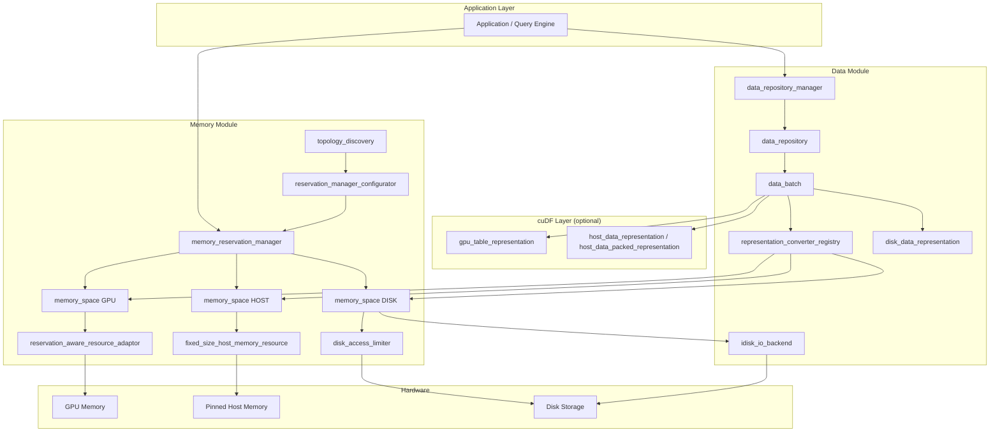
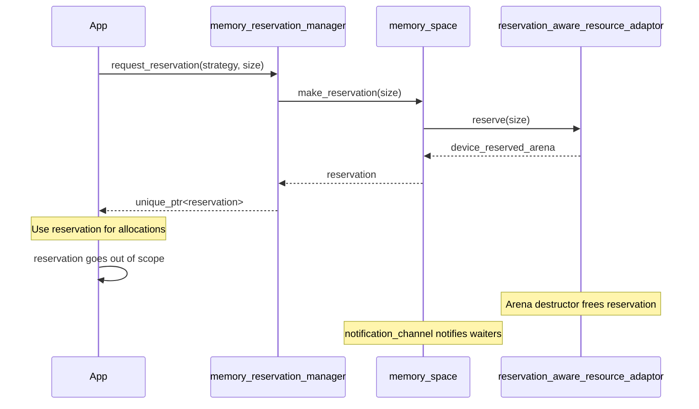
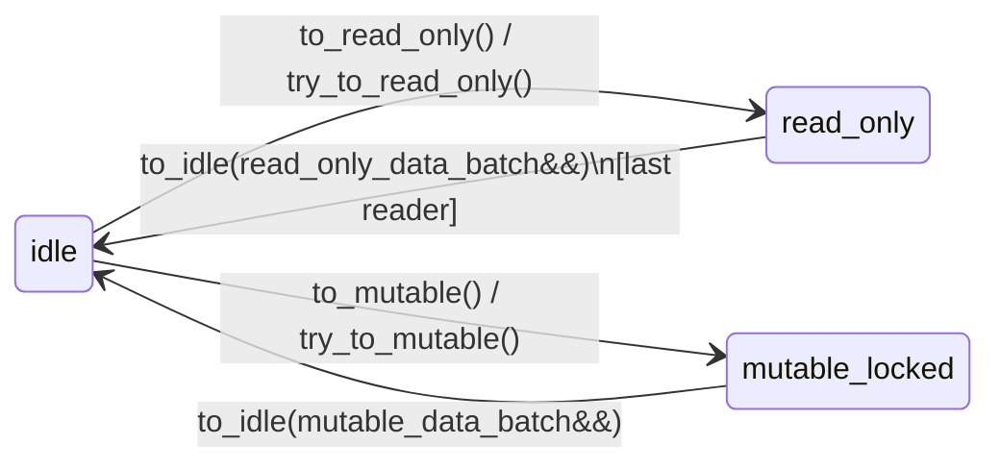

# Architecture Overview

A high-level description of cuCascade's design, core components, and how they work together.

## Table of Contents

- [Overview](#overview)
- [System Architecture](#system-architecture)
- [Memory Tier System](#memory-tier-system)
- [Core Components](#core-components)
  - [Memory Reservation Manager](#memory-reservation-manager)
  - [Memory Spaces](#memory-spaces)
  - [Reservation System](#reservation-system)
  - [Data Batch Lifecycle](#data-batch-lifecycle)
  - [Data Repositories](#data-repositories)
  - [Representation Converter](#representation-converter)
  - [Topology Discovery](#topology-discovery)
- [End-to-End Data Flow](#end-to-end-data-flow)
- [Thread Safety Model](#thread-safety-model)
- [Design Patterns](#design-patterns)
- [Key Source Files](#key-source-files)

---

## Overview

cuCascade is a GPU memory management library for data-intensive applications that need to process more data than fits in GPU memory. It solves a fundamental problem: GPU memory is fast but limited, while host memory and disk are larger but slower.

Rather than failing when GPU memory runs out, cuCascade provides:

- **Tiered memory** -- seamlessly allocate across GPU, pinned host, and disk storage
- **Reservation-based allocation** -- prevent GPU oversubscription by reserving memory upfront
- **Data movement between tiers** -- convert batches between tiers, with configurable pressure thresholds that signal when to move data down
- **Hardware-aware placement** -- discover NUMA topology and place memory optimally
- **Safe concurrent access** -- RAII read-only and mutable accessor classes protect data during multi-threaded processing

cuCascade is built as several libraries:

- **`cucascade`** (core) -- the memory and data modules described here, including the disk tier. It depends on RMM, CUDA and libnuma, not on cuDF.
- **`cucascade_topology_discovery`** -- NVML/sysfs topology discovery (`topology_discovery.hpp`); linked by the core and buildable alone with `CUCASCADE_TOPOLOGY_ONLY`.
- **`cucascade_cudf`** (on by default; `CUCASCADE_BUILD_CUDF=OFF` disables it) -- the cuDF-backed GPU and host representations, the built-in converters, the bandwidth profiler and, with `CUCASCADE_BUILD_IO`, a cuDF datasource bridge (`include/cucascade/cudf/`).
- **`cucascade_io`** (on by default; `CUCASCADE_BUILD_IO=OFF` disables it) -- an asynchronous I/O layer (`include/cucascade/io/`, `include/cucascade/exec/`) with local and object-store datasources and a prefetching cache. It is not covered in this document.

## System Architecture



## Memory Tier System

cuCascade organizes memory into three tiers, each with different performance and capacity characteristics:

| Tier | Backing | Speed | Capacity | Allocator |
|------|---------|-------|----------|-----------|
| **GPU** | Device VRAM | Fastest | Limited (8-80 GB typical) | `reservation_aware_resource_adaptor` |
| **HOST** | Pinned CPU RAM | Medium | Large (64-512 GB typical) | `fixed_size_host_memory_resource` |
| **DISK** | NVMe/SSD | Slowest | Very large (TB+) | `disk_access_limiter` |

Each tier is identified by a `memory_space_id` -- a `(Tier, device_id)` pair. For example, GPU device 0 is `(GPU, 0)`, NUMA node 1's host memory is `(HOST, 1)`.

Data flows downward (GPU -> HOST -> DISK) when memory pressure is high (**downgrade**), and upward (DISK -> HOST -> GPU) when data is needed for processing (**upgrade**).

---

## Core Components

### Memory Reservation Manager

**File**: `include/cucascade/memory/memory_reservation_manager.hpp`

The `memory_reservation_manager` is the central coordinator for all memory operations. It owns all `memory_space` instances and provides a strategy-based interface for requesting memory reservations.

```cpp
// Request 1GB on any available GPU
auto reservation = manager.request_reservation(
    any_memory_space_in_tier(Tier::GPU), 1ULL << 30);

// Request on a specific host NUMA node
auto host_res = manager.request_reservation(
    specific_memory_space(Tier::HOST, 0), 2ULL << 30);
```

**Reservation request strategies** (Strategy pattern):

| Strategy | Behavior |
|----------|----------|
| `any_memory_space_in_tier(tier)` | Any space in the given tier |
| `any_memory_space_in_tier_with_preference(tier, device)` | Preferred device first; if it exists, blocks on it rather than falling back (other devices are tried only if it is shut down) |
| `specific_memory_space(tier, device)` | Exact memory space, no fallback |
| `any_memory_space_in_tiers(tiers)` | Try tiers in preference order |
| `any_memory_space_to_downgrade(src, target_tier)` | Stub: returns no candidates, so a request never returns |
| `any_memory_space_to_upgrade(src, target_tier)` | Stub: returns no candidates, so a request never returns |

If no candidate space can satisfy a request immediately, `memory_space::make_reservation()` blocks on that space's `notification_channel` until a reservation on it is released. If no reservations remain outstanding on that space, it stops waiting and returns `make_reservation_upto(size)`.

### Memory Spaces

**File**: `include/cucascade/memory/memory_space.hpp`

A `memory_space` represents a single memory location (e.g., one GPU, one NUMA node, one disk mount). It holds:

- A tier-specific **allocator** (the actual memory resource)
- A **reservation allocator** that tracks and enforces reservations
- A **stream pool** for CUDA stream management (GPU spaces only)
- A **disk I/O backend** (`idisk_io_backend`) that reads and writes its files (DISK spaces only)
- A **notification channel** for signaling when memory is freed
- **Downgrade thresholds** controlling when data should be moved to a slower tier

```
memory_space (GPU, device 0)
├── allocator: rmm::cuda_async_memory_resource
├── reservation_allocator: reservation_aware_resource_adaptor
├── stream_pool: rmm::cuda_stream_pool (16 streams)
├── notification_channel: shared_ptr<notification_channel>
├── capacity: 8 GB
├── reservation_limit: 7.2 GB (90%)
├── downgrade_trigger: 6 GB (75%)
└── downgrade_stop: 5.2 GB (65%)
```

### Reservation System

**File**: `include/cucascade/memory/memory_reservation.hpp`

Reservations guarantee that a certain amount of memory is available before any allocation happens. This prevents GPU oversubscription in multi-tenant scenarios.



**Reservation limit policies** control what happens when an allocation exceeds its stream's reservation:

| Policy | Behavior |
|--------|----------|
| `ignore_reservation_limit_policy` | Allows over-reservation (soft limits) (default) |
| `fail_reservation_limit_policy` | Throws `rmm::out_of_memory` |
| `increase_reservation_limit_policy` | Grows the reservation by the shortfall times a padding factor (default 1.25), falling back to the exact shortfall; throws `rmm::out_of_memory` if neither fits |

### Data Batch Lifecycle

**File**: `include/cucascade/data/data_batch.hpp`

A `data_batch` is the fundamental unit of data in cuCascade. It wraps a tier-specific data representation (GPU table, host table, or disk file) and manages concurrent access through RAII read-only and mutable accessor classes. Batches are created with `data_batch::make()`, which returns a `shared_ptr`; the idle batch itself gives no access to its data.



**States**:
- **idle** -- no accessor is held; the batch is available for reading, mutation, or tier conversion
- **read_only** -- one or more `read_only_data_batch` accessors hold a shared lock
- **mutable_locked** -- one `mutable_data_batch` accessor holds the exclusive lock; tier conversion (`convert_to<T>()`) happens here

The accessors hold a `std::shared_mutex` lock that is released when they are destroyed or passed to `data_batch::to_idle()`, even on exceptions. There is no direct `read_only` <-> `mutable_locked` transition. See [data_batch State Transitions](data_batch_state_transitions.md) for the full reference.

### Data Repositories

**File**: `include/cucascade/data/data_repository.hpp`

A `data_repository` stores shared batches and optional partition-local positions under a mutex.
All retrieval is non-blocking and independent of batch state: pops and lookups neither lock nor
transition the returned batch. The repository is default-constructed; its batch-positioning mode
(`ORDERED` or `UNORDERED`) is established by the first successful insertion, applies to all
partitions, and persists after draining.

```cpp
// FIFO pop: arrival order, with optional logical sequence metadata.
// An empty partition returns {nullptr, std::nullopt}.
auto [batch, position] = repository.pop_next_data_batch_with_position();
```

The `data_repository_manager` coordinates multiple repositories across operators/pipelines and provides atomic batch ID generation.

FIFO and by-ID pops work in every mode; the plain variants discard the position, while the
`_with_position` variants return it. Mixing positioned and unpositioned insertion throws
`repository_ordering_error`. Memory management can enumerate IDs and inspect payloads without
removing them. Sorted position snapshots and position lookup (`ORDERED` repositories only)
enable ordered consumption after successful producer completion, coordinated by the caller. The
repository does not infer completion or sortedness. See
[Data Repositories](data-management.md#data-repositories) for the full contract.

### Representation Converter

**File**: `include/cucascade/data/representation_converter.hpp`

The `representation_converter_registry` provides type-indexed conversion between data representations. Converters are registered as functions keyed by `(source_type, target_type)`.

The core registry starts empty. **Built-in converters** are part of the optional `cucascade_cudf` library and are added by `register_builtin_converters()` (`include/cucascade/cudf/builtin_converters.hpp`):

| Source | Target | Method |
|--------|--------|--------|
| GPU table | Host (direct) | `cudaMemcpyBatchAsync` (D2H) — copies column buffers directly into host blocks |
| Host (direct) | GPU table | `cudaMemcpyBatchAsync` (H2D) — reconstructs `cudf::column` tree from metadata |
| GPU table | Host (packed) | `cudf::pack()` -> `cudaMemcpyAsync` (D2H) -> multi-block host allocation |
| Host (packed) | GPU table | `cudaMemcpyAsync` (H2D) into one device buffer -> `cudf::unpack()` (host-side metadata) -> deep copy into a new `cudf::table` |
| GPU table | GPU table | Same device: `clone()`. Cross-device: per-buffer `cudaMemcpyPeerAsync`, staged through pinned host memory when `probe_peer_dma_works()` does not verify the direction |
| Host (direct) | Host (direct) | Block-by-block `std::memcpy` (cross-NUMA) |
| Host (packed) | Host (packed) | Block-by-block `std::memcpy` (cross-NUMA) |
| Host (direct) | Disk | Writes each column buffer through the DISK space's `idisk_io_backend` at 4 KiB-aligned file offsets |
| Disk | Host (direct) | Reads column buffers into host blocks through the `idisk_io_backend` |
| GPU table | Disk | Passes the device buffers to `idisk_io_backend::write_batch()` with no intermediate `host_data_representation`; the default `pipeline` backend stages them through its own pinned host buffers |
| Disk | GPU table | Reads column buffers into newly allocated device buffers through the `idisk_io_backend` |

Disk files hold only the column data; the column metadata stays in memory in the `disk_data_representation`, which deletes its file on destruction.

"Host (direct)" = `host_data_representation` — preferred, no intermediate GPU allocation.
"Host (packed)" = `host_data_packed_representation` — uses cudf's pack/unpack serialization.

### Topology Discovery

**File**: `include/cucascade/memory/topology_discovery.hpp`

The `topology_discovery` class detects the hardware layout at runtime using NVML and the `/sys` filesystem. It discovers:

- GPU devices with PCIe bus IDs and UUIDs
- NUMA node assignments for each GPU
- CPU core affinity per GPU
- Network devices (InfiniBand/RoCE NICs) with NUMA affinity
- NVMe controllers with NUMA affinity
- GPU-NIC proximity estimates used to select preferred NICs

Network device discovery is controlled by `NetworkDeviceVerification`, which determines how strictly devices are validated. By default (`EXISTS_ACTIVE_IP`), a device must exist, have an active port, and have an IP address on its net interface. Less strict levels (`EXISTS_ACTIVE`, `EXISTS`) relax these checks. See [topology-and-configuration.md](topology-and-configuration.md#network-device-verification) for details.

This information feeds into `reservation_manager_configurator` to automatically bind host memory spaces to the correct NUMA nodes for each GPU.

---

## End-to-End Data Flow

A typical lifecycle of data through cuCascade:

```
1. INGESTION
   Create data representation (e.g., gpu_table_representation wrapping a cuDF table)
   -> data_batch::make(repo_manager.get_next_data_batch_id(), std::move(representation))
   -> repository->add_data_batch(batch, partition_idx)

2. RETRIEVAL
   repository->pop_next_data_batch(partition_idx)  [non-blocking; nullptr if empty]

3. PROCESSING
   batch->to_read_only()                   [idle -> read_only]
   -> Access data via accessor.get_data()
   -> accessor.record_reader_event(stream) [if GPU reads were enqueued]
   -> Accessor destructs on scope exit     [read_only -> idle]

4. MEMORY PRESSURE (downgrade)
   memory_space.should_downgrade_memory()  [threshold exceeded]
   auto reservation = reservation_manager.request_reservation(any_memory_space_in_tier(Tier::HOST), size)
   auto accessor = batch->to_mutable()     [idle -> mutable_locked]
   accessor.convert_to<host_data_representation>(registry, *reservation, stream)
                                           [data now on HOST]
   Accessor destructs on scope exit        [mutable_locked -> idle]

5. DATA NEEDED (upgrade)
   Same flow as downgrade but in reverse tier direction

6. CLEANUP
   repo_manager.clear_all_repositories()   [destroys all repositories; returns those that still held batches]
```

---

## Thread Safety Model

cuCascade uses a strict lock hierarchy to prevent deadlocks:

```
Level 1: atomic<uint64_t> (batch ID generation -- lock-free)
    |
Level 2: data_batch, read_only_data_batch, mutable_data_batch (3-class system provides read-only and mutable access classes)
    |
Level 3: data_repository_manager._mutex (protects repository map; may be held while taking a repository mutex)
    |
Level 4: data_repository._mutex (protects batch storage)
    |
Level 5: representation_converter_registry._mutex (protects converter map)
    |
Level 6: memory_reservation_manager._wait_mutex (protects reservation waiting)
```

Key synchronization primitives:
- **`std::mutex`** -- guards repository storage and configuration
- **`std::shared_mutex`** -- per-batch reader/writer lock held by `read_only_data_batch` and `mutable_data_batch`
- **`std::condition_variable`** -- blocks reservation waiters inside `notification_channel` until memory is freed
- **`std::atomic`** -- lock-free counters for batch IDs, allocated bytes, and peak tracking
- **`atomic_bounded_counter`** -- CAS-based bounded arithmetic for reservation enforcement
- **`notification_channel`** -- signals waiting threads when reservations are released

---

## Design Patterns

| Pattern | Where Used |
|---------|-----------|
| **Strategy** | `reservation_request_strategy` subclasses for memory selection |
| **Builder** | `reservation_manager_configurator` for fluent system configuration |
| **RAII** | `read_only_data_batch`, `mutable_data_batch`, `disk_data_representation`, `borrowed_stream`, `multiple_blocks_allocation`, `notify_on_exit` |
| **Factory** | `DeviceMemoryResourceFactoryFn` for tier-specific allocator creation |
| **Adapter** | `reservation_aware_resource_adaptor` wraps RMM resources with tracking |
| **3-Class System** | `data_batch` with read-only and mutable class variants which provide locking and accessors |
| **Observer** | `notification_channel` / `event_notifier` for memory release signaling |
| **Type-Indexed Registry** | `representation_converter_registry` keyed by `(source_type, target_type)` |
| **Named Registry** | `io_backend_registry` maps backend names to `idisk_io_backend` factories |
| **Variant** | `memory_space_config` for tier-specific configuration, `reserving_adaptor_type` for allocators |

---

## Key Source Files

### Memory Module

| File | Purpose |
|------|---------|
| `include/cucascade/memory/common.hpp` | `Tier` enum, `memory_space_id`, factory functions |
| `include/cucascade/memory/config.hpp` | Configuration structs for GPU, HOST, DISK |
| `include/cucascade/memory/memory_reservation_manager.hpp` | Central reservation coordinator and strategies |
| `include/cucascade/memory/memory_space.hpp` | Per-location memory container |
| `include/cucascade/memory/memory_reservation.hpp` | Reservation objects, arenas, and limit policies |
| `include/cucascade/memory/reservation_aware_resource_adaptor.hpp` | GPU allocator with per-stream tracking |
| `include/cucascade/memory/fixed_size_host_memory_resource.hpp` | Block-based pinned host allocator |
| `include/cucascade/memory/disk_access_limiter.hpp` | Disk tier reservation tracker |
| `include/cucascade/memory/topology_discovery.hpp` | NVML-based hardware topology detection |
| `include/cucascade/memory/reservation_manager_configurator.hpp` | Builder for system configuration |
| `include/cucascade/memory/notification_channel.hpp` | Cross-reservation signaling |
| `include/cucascade/memory/stream_pool.hpp` | CUDA stream pool with RAII borrowing |
| `include/cucascade/memory/oom_handling_policy.hpp` | OOM handling strategies |
| `include/cucascade/memory/error.hpp` | Custom error types and exceptions |
| `include/cucascade/memory/numa_region_pinned_host_allocator.hpp` | NUMA-aware pinned host allocation |
| `include/cucascade/memory/column_metadata.hpp` | `column_metadata` describing column buffers for host and disk representations |
| `include/cucascade/memory/disk_table.hpp` | `disk_table_allocation` (file path + column metadata) and disk file path generation |
| `include/cucascade/memory/null_device_memory_resource.hpp` | No-op resource for disk tier |

### Data Module

| File | Purpose |
|------|---------|
| `include/cucascade/data/common.hpp` | `idata_representation` interface |
| `include/cucascade/data/data_batch.hpp` | Batch lifecycle, read-only and mutable locking accessor classes|
| `include/cucascade/data/data_repository.hpp` | Partitioned batch storage with optional positions and non-blocking pops |
| `include/cucascade/data/data_repository_manager.hpp` | Multi-pipeline repository coordination |
| `include/cucascade/data/representation_converter.hpp` | Type-indexed converter registry |
| `include/cucascade/data/disk_data_representation.hpp` | Disk-resident table; deletes its file on destruction |
| `include/cucascade/data/disk_io_backend.hpp` | `idisk_io_backend` interface for disk reads and writes |
| `include/cucascade/data/io_backend_registry.hpp` | Named registry of disk I/O backend factories (built-in: `pipeline`) |
| `include/cucascade/data/disk_file_format.hpp` | Disk file alignment constant |
| `include/cucascade/utils/atomics.hpp` | `atomic_peak_tracker`, `atomic_bounded_counter` |
| `include/cucascade/utils/overloaded.hpp` | Variant visitor helper |

### cuDF Layer

| File | Purpose |
|------|---------|
| `include/cucascade/cudf/gpu_data_representation.hpp` | GPU-resident cuDF table wrapper |
| `include/cucascade/cudf/host_data_representation.hpp` | `host_data_representation` (direct buffer copy) and `host_data_packed_representation` (cudf::pack) |
| `include/cucascade/cudf/host_table.hpp` | `host_table_allocation` for direct-copy host representations |
| `include/cucascade/cudf/host_table_packed.hpp` | `host_table_packed_allocation` for packed (cudf::pack) host representations |
| `include/cucascade/cudf/builtin_converters.hpp` | `register_builtin_converters()` for GPU, host, and disk converters |
