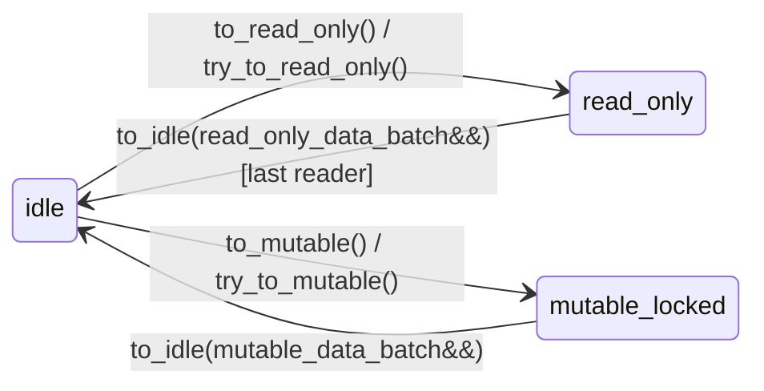
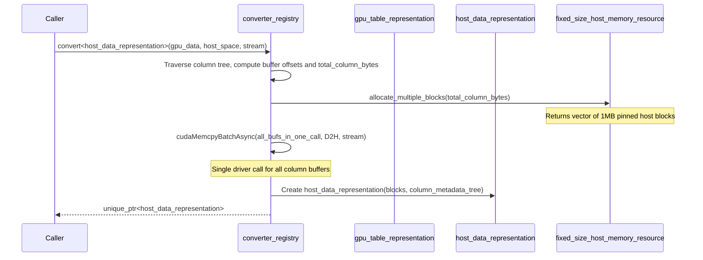
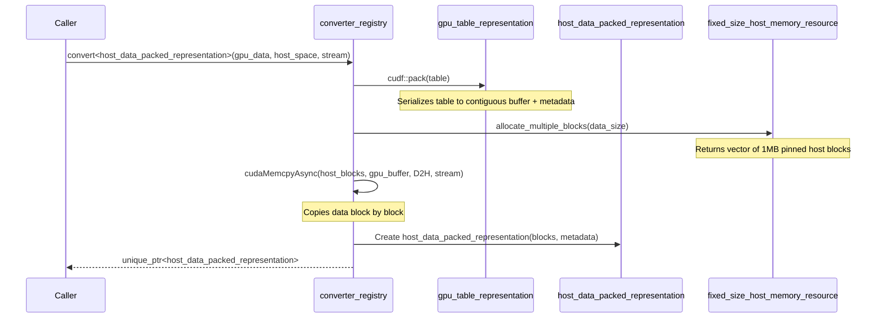

# Data Management

A deep dive into cuCascade's data lifecycle, batch read-only and mutable locking accessor classes, repositories, and representation conversion.

## Table of Contents

- [Overview](#overview)
- [Data Representations](#data-representations)
  - [Interface: idata_representation](#interface-idata_representation)
  - [GPU Table Representation](#gpu-table-representation)
  - [Host Table Representation (Direct Copy)](#host-table-representation-direct-copy)
  - [Host Table Representation (Packed)](#host-table-representation-packed)
  - [Disk Representation](#disk-representation)
- [Data Batch Lifecycle](#data-batch-lifecycle)
  - [States](#states)
  - [State Transitions](#state-transitions)
  - [RAII Accessor Classes](#raii-accessor-classes)
  - [Thread Safety](#thread-safety)
  - [Subscriber Counting](#subscriber-counting)
  - [Cloning](#cloning)
- [Representation Conversion](#representation-conversion)
  - [Converter Registry](#converter-registry)
  - [Built-in Converters](#built-in-converters)
  - [Conversion Flow](#conversion-flow)
- [Data Repositories](#data-repositories)
  - [Add and Pop Semantics](#add-and-pop-semantics)
  - [Partitioning](#partitioning)
  - [Batch Positions and Ordering](#batch-positions-and-ordering)
  - [Ordered Consumption](#ordered-consumption)
  - [Choosing a Retrieval API](#choosing-a-retrieval-api)
  - [Shared Ownership](#shared-ownership)
- [Data Repository Manager](#data-repository-manager)
  - [Operator Port Keys](#operator-port-keys)
  - [Batch ID Generation](#batch-id-generation)
  - [Publishing Through Repositories](#publishing-through-repositories)
- [Integration with Memory Module](#integration-with-memory-module)
- [Key Source Files](#key-source-files)

---

## Overview

The data module manages the lifecycle of data as it flows through processing pipelines and moves between memory tiers. It provides:

- **Tier-agnostic data representations** -- abstract interface with GPU, host and disk implementations
- **Locking read-only and mutable accessor classes for batch lifecycle** -- prevents concurrent access conflicts during processing and tier movement
- **Type-indexed conversion** -- extensible registry for converting data between representations
- **Partitioned repositories** -- thread-safe storage with non-blocking retrieval and optional batch positions
- **Multi-pipeline coordination** -- manages data across operators with atomic ID generation

The data module depends on the memory module for allocators, memory spaces, and CUDA streams.

The core `cucascade` library is cudf-free: it provides the interfaces, `data_batch`, repositories,
the converter registry and the disk representation. The cudf-backed GPU and host representations
and the built-in converters live in the `cucascade_cudf` library (headers under
`include/cucascade/cudf/`), which is built when `CUCASCADE_BUILD_CUDF=ON`.

## Data Representations

### Interface: idata_representation

**File**: `include/cucascade/data/common.hpp`

All data in cuCascade is accessed through the `idata_representation` interface:

```cpp
class idata_representation {
public:
    virtual std::size_t get_size_in_bytes() const = 0;
    virtual std::size_t get_uncompressed_data_size_in_bytes() const = 0;
    virtual std::unique_ptr<idata_representation> clone(::cuda::stream_ref stream) const = 0;

    // GPU writer ordering; the defaults are no-ops (get_writer_event() returns nullptr)
    virtual void record_writer_event(::cuda::stream_ref writer_stream);
    virtual cudaEvent_t get_writer_event() const;
    virtual void rebind_stream(::cuda::stream_ref stream);

    template <class TargetType>
      requires std::derived_from<TargetType, idata_representation>
    TargetType& cast();              // dynamic_cast; throws std::bad_cast on a type mismatch
    template <class TargetType>
      requires std::derived_from<TargetType, idata_representation>
    const TargetType& cast() const;  // const overload

    memory::Tier get_current_tier() const;
    int get_device_id() const;
    memory::memory_space& get_memory_space() const;
};
```

Data representations are thin wrappers -- they hold the data but delegate storage details (tier, device, allocator) to their associated `memory_space`.
GPU representations override the writer-event hooks; see
[Batch Positions and Ordering](#batch-positions-and-ordering) for the cross-stream contract.

### GPU Table Representation

**File**: `include/cucascade/cudf/gpu_data_representation.hpp`

Wraps a `cudf::table` residing in GPU device memory:

```cpp
class gpu_table_representation : public idata_representation {
    // An owned cudf::table, or a cudf::table_view kept alive by a type-erased owner
    std::variant<std::unique_ptr<cudf::table>, owning_table_view> _table;
    cudaEvent_t _writer_event;  // Recorded on the most recent writer stream; null if unknown

public:
    cudf::table_view get_table_view() const;
    std::unique_ptr<cudf::table> release_table(::cuda::stream_ref stream);  // Transfer ownership
    void wait_for_writer(::cuda::stream_ref reader_stream) const;

    std::size_t get_size_in_bytes() const override;
    std::unique_ptr<idata_representation> clone(::cuda::stream_ref stream) const override;
};
```

- The constructors record a writer event on the given writer stream; a null stream handle means
  the writer is unknown and records none. `make_written_on()` (and `record_writer_event()`) treat
  a null handle as the default stream instead. `wait_for_writer()` waits for the event, or
  synchronizes the whole device when the writer is unknown
- `clone()` performs a deep copy using `cudf::table(get_table_view(), stream)` after waiting for
  the writer

### Host Table Representation (Direct Copy)

**File**: `include/cucascade/cudf/host_data_representation.hpp`

The preferred host representation. Directly copies each column's GPU device buffers into pinned
host memory without an intermediate GPU-side contiguous allocation. Column layout is described by
custom per-column `column_metadata` structs, enabling reconstruction without cudf's pack format.

```cpp
class host_data_representation : public idata_representation {
    std::unique_ptr<memory::host_table_allocation> _host_table;

public:
    const std::unique_ptr<memory::host_table_allocation>& get_host_table() const;

    std::size_t get_size_in_bytes() const override;
    std::unique_ptr<idata_representation> clone(::cuda::stream_ref stream) const override;
};
```

A `host_table_allocation` (`include/cucascade/cudf/host_table.hpp`) contains:
- `allocation` -- shared `multiple_blocks_allocation` (vector of fixed-size pinned memory blocks)
- `columns` -- per-column `column_metadata` trees describing buffer offsets, sizes, and nesting
- `data_size` -- number of data bytes referenced by `columns` (for a `slice()`, only the selected
  columns' buffers)

Each `column_metadata` node (`include/cucascade/memory/column_metadata.hpp`) captures `type_id`,
`num_rows`, `null_count`, `scale` (for decimals), plus buffer offsets/sizes for the null mask and
data buffer, and recursive `children` for nested types (LIST, STRUCT, STRING, DICTIONARY32).

This representation avoids the extra GPU allocation and GPU-to-GPU copy that `cudf::pack` performs.
`cudaMemcpyBatchAsync` batches the column buffer copies into one driver call for D2H. For H2D it
batches most buffers, but the masks of columns with nulls are copied synchronously one at a time,
and INT32 string offsets force an extra flush. Builds older than CUDA 12.8 fall back to one
`cudaMemcpyAsync` per buffer.

`clone()` copies each column's null-mask and data buffers with `std::memcpy` into a newly
allocated, compact 8-byte-aligned layout and rebuilds the `column_metadata` tree with the new
offsets.

### Host Table Representation (Packed)

**File**: `include/cucascade/cudf/host_data_representation.hpp`

A legacy representation that uses `cudf::pack()` to serialize the table to a contiguous GPU buffer
before copying it to host memory. Useful when cudf's serialization format is required.

```cpp
class host_data_packed_representation : public idata_representation {
    std::unique_ptr<memory::host_table_packed_allocation> _host_table;

public:
    const std::unique_ptr<memory::host_table_packed_allocation>& get_host_table() const;

    std::size_t get_size_in_bytes() const override;
    std::unique_ptr<idata_representation> clone(::cuda::stream_ref stream) const override;
};
```

A `host_table_packed_allocation` (`include/cucascade/cudf/host_table_packed.hpp`) contains:
- `allocation` -- `multiple_blocks_allocation` (vector of fixed-size pinned memory blocks)
- `metadata` -- serialized cuDF table metadata from `cudf::pack()` (for reconstruction via `cudf::unpack()`)
- `data_size` -- actual data size in bytes

`clone()` copies data block-by-block with `std::memcpy` and duplicates the metadata vector.

### Disk Representation

**File**: `include/cucascade/data/disk_data_representation.hpp`

The disk tier representation, part of the cudf-free core. It owns a `disk_table_allocation`
(`include/cucascade/memory/disk_table.hpp`):

```cpp
class disk_data_representation : public idata_representation {
    std::unique_ptr<memory::disk_table_allocation> _disk_table;

public:
    const memory::disk_table_allocation& get_disk_table() const;

    std::size_t get_size_in_bytes() const override;
    std::unique_ptr<idata_representation> clone(::cuda::stream_ref stream) const override;  // throws
};
```

- `disk_table_allocation` holds the backing `file_path`, the `column_metadata` trees with file
  offsets, and `data_size` (file data extent including alignment padding)
- The file holds only column data buffers, each aligned to `DISK_FILE_ALIGNMENT` (4096 bytes,
  `include/cucascade/data/disk_file_format.hpp`); the column metadata stays in memory
- The destructor deletes the backing file (best effort, errors are discarded)
- `clone()` always throws `cucascade::logic_error`; materialize the data to another tier through a
  converter instead
- File I/O goes through the `idisk_io_backend` held by the DISK `memory_space`
  (`memory_space::get_io_backend()`), which is the pipeline backend unless another backend is
  passed to the `memory_space` constructor. Separately, `io_backend_registry`
  (`include/cucascade/data/io_backend_registry.hpp`) lets applications create backends by name.
  It starts empty (call `register_builtin_io_backends()` to add `"pipeline"`, its default name),
  and `memory_space` does not consult it

---

## Data Batch Lifecycle

### States

**File**: `include/cucascade/data/data_batch.hpp`

A `data_batch` wraps a data representation and controls access through three states using a
reader-writer lock model. Data is only accessible through RAII accessor objects that hold the
appropriate lock — the idle `data_batch` pointer grants no data access.

Construct batches with the factory so they are always managed by the shared ownership required by the transition API:

```cpp
auto batch = data_batch::make(batch_id, std::move(representation));
```

| State | Meaning |
|-------|---------|
| `idle` | No active locks. Available for reading, mutation, or tier movement. |
| `read_only` | One or more `read_only_data_batch` shared locks are active (`_read_only_count > 0`). Concurrent readers allowed; exclusive access blocked. |
| `mutable_locked` | One `mutable_data_batch` exclusive lock is active. No concurrent readers; full read/write access. |

### State Transitions



**Key rules**:
- Non-static transitions (`to_read_only`, `to_mutable`, `try_to_*`) use `shared_from_this()` and do not consume the caller's `shared_ptr`.
- The static `to_idle()` overloads consume the accessor via `&&`, leaving the moved-from accessor empty at the call site. They return the parent batch: `shared_ptr<const data_batch>` for a read-only accessor, `shared_ptr<data_batch>` for a mutable one.
- `to_read_only()` / `to_mutable()` **block** until the lock is available. `to_mutable()` also waits for registered GPU reader events (see `read_only_data_batch::record_reader_event()`).
- `try_to_read_only()` / `try_to_mutable()` do not wait for the batch lock and return `std::nullopt` on failure; `try_to_mutable()` also fails while registered reader events are pending, and may block on the internal reader-event mutex while another thread's `to_mutable()` synchronizes GPU reader events.
- There is no in-place upgrade or downgrade: release the current accessor first. Calling `to_mutable()` while the same thread still holds a `read_only_data_batch` on that batch deadlocks.
- Multiple `read_only_data_batch` handles may coexist on the same batch (concurrent reads).
- `mutable_data_batch` is exclusive: it cannot coexist with any other reader or writer.
- Copying a `read_only_data_batch` acquires a new shared lock on the parent, incrementing `_read_only_count`.

See [data_batch_state_transitions.md](data_batch_state_transitions.md) for the complete reference.

### RAII Accessor Classes

Access to batch data is only possible through one of two RAII accessor classes:

**`read_only_data_batch`** — shared (read) lock:

```cpp
// Acquire shared lock (blocks if exclusive lock held)
read_only_data_batch ro = batch->to_read_only();

// Access data
const auto& data = ro.get_data()->cast<gpu_table_representation>();
process(data.get_table_view());

// Release: either let ro go out of scope, or explicitly return to idle
auto idle_batch = cucascade::data_batch::to_idle(std::move(ro));
```

Properties:
- **Copyable** — each copy acquires a new shared lock; `_read_only_count` increments per copy.
- **Movable** — moves transfer lock ownership without changing the count.
- Destruction or `to_idle()` decrements `_read_only_count`; the batch returns to `idle` when the count reaches zero.

**`mutable_data_batch`** — exclusive (write) lock:

```cpp
// Acquire exclusive lock (blocks until all readers and writers release)
mutable_data_batch mut = batch->to_mutable();

// Read and write data
mut.set_data(std::move(new_representation));

// Release back to idle
auto idle_batch = cucascade::data_batch::to_idle(std::move(mut));
```

Properties:
- **Move-only** — no copies allowed; only one exclusive lock can exist at a time.
- Destruction or `to_idle()` releases the exclusive lock.

Prefer `mut.convert_to<TargetRepresentation>(registry, target_space, stream)` over `set_data()`
when moving data between tiers: it reports the conversion to the batch's `idata_batch_probe` and
synchronizes the stream before the old representation is freed when either side is on the GPU.

**Switching between read-only and mutable access**:

```cpp
// Release the shared lock first, then acquire the exclusive lock (may block)
cucascade::data_batch::to_idle(std::move(ro));
mutable_data_batch mut = batch->to_mutable();

// Exclusive to shared works the same way
cucascade::data_batch::to_idle(std::move(mut));
read_only_data_batch ro2 = batch->to_read_only();
```

Another thread may acquire the batch between the release and the new acquisition.

### Thread Safety

Each `data_batch` uses a `std::shared_mutex`: shared locks for readers (`read_only_data_batch`) and unique locks for writers (`mutable_data_batch`). The observable state (`batch_state` enum) is tracked atomically so it can be queried without acquiring the mutex. `_read_only_count` is also atomic for lock-free reader-count queries.

### Subscriber Counting

Independent of the locking model, batches support a subscriber reference count:

```cpp
batch->subscribe();          // Increment interest count (lock-free)
batch->unsubscribe();        // Decrement interest count (lock-free)
batch->get_subscriber_count(); // Query count (lock-free)
```

The library does not interpret the count; applications (for example a pipeline scheduler or downgrade policy) can use it to track which batches are still of interest, independently of whether they are currently locked. `unsubscribe()` throws `std::runtime_error` if the count is already zero.

### Cloning

```cpp
// Via read-only accessor (caller already holds lock)
read_only_data_batch ro = batch->to_read_only();
auto cloned = ro.clone(new_batch_id, stream);

// With representation conversion
auto cloned = ro.clone_to<host_data_representation>(registry, new_batch_id, host_space, stream);
```

Cloning produces a new `shared_ptr<data_batch>` in `idle` state with the given ID. The clone
contains a deep copy of the data representation, residing in the same memory space as the original
(or a different space when using `clone_to`). `mutable_data_batch` offers the same `clone` and
`clone_to` methods, and `clone_to` also accepts a `memory::reservation&` in place of the target
memory space. `clone()` throws for a disk-resident batch; use `clone_to` to materialize it on
another tier.

---

## Representation Conversion

### Converter Registry

**File**: `include/cucascade/data/representation_converter.hpp`

The `representation_converter_registry` stores conversion functions indexed by `(source_type, target_type)`:

```cpp
// Register a custom converter
registry.register_converter<gpu_table_representation, host_data_representation>(
    [](const idata_representation& source,
       const memory::memory_space* target,
       ::cuda::stream_ref stream,
       memory::reservation* reservation)
        -> std::unique_ptr<idata_representation> {
        // Convert GPU table to host (direct copy)
        return ...;
    }
);

// Convert data
auto host_data = registry.convert<host_data_representation>(
    *gpu_data, target_host_space, stream);

// Convert using a caller-owned target reservation
auto reserved_host_data = registry.convert<host_data_representation>(
    *gpu_data, target_reservation, stream);
```

The registry is thread-safe: a `std::shared_mutex` allows concurrent lookups and conversions,
while registration and removal take it exclusively.

### Built-in Converters

The core registry ships empty. `register_builtin_converters(registry)`, declared in
`include/cucascade/cudf/builtin_converters.hpp` and part of `cucascade_cudf`, registers:

| Source | Target | Method |
|--------|--------|--------|
| `gpu_table_representation` | `host_data_representation` | `cudaMemcpyBatchAsync` (D2H) — copies each column's buffers directly to pinned host blocks; ~99% PCIe bandwidth |
| `host_data_representation` | `gpu_table_representation` | Allocates `rmm::device_buffer` per column buffer, `cudaMemcpyBatchAsync` (H2D), reconstructs `cudf::column` tree |
| `host_data_representation` | `host_data_representation` | Block-by-block `std::memcpy` + column metadata copy (cross-NUMA copy) |
| `gpu_table_representation` | `host_data_packed_representation` | `cudf::pack()` on GPU -> `cudaMemcpyAsync` (D2H) to multi-block host allocation |
| `host_data_packed_representation` | `gpu_table_representation` | `cudaMemcpyAsync` (H2D) from host blocks -> `cudf::unpack()` -> copy into a new `cudf::table` |
| `host_data_packed_representation` | `host_data_packed_representation` | Block-by-block `std::memcpy` + metadata copy (cross-NUMA copy) |
| `gpu_table_representation` | `gpu_table_representation` | Same device: `clone()`. Cross device: per-buffer `cudaMemcpyPeerAsync`, or a copy staged through pinned host blocks when peer DMA does not work |
| `host_data_representation` | `disk_data_representation` | Writes each column buffer from the host blocks to a new file through the disk space's I/O backend |
| `disk_data_representation` | `host_data_representation` | Reads each column buffer from the file into newly allocated pinned host blocks |
| `gpu_table_representation` | `disk_data_representation` | Writes all GPU column buffers to a new file with one `write_batch()` call on the I/O backend |
| `disk_data_representation` | `gpu_table_representation` | Allocates device buffers and fills each one with a device read on the disk space's I/O backend (the default pipeline backend stages the data through pinned host buffers), then reconstructs the `cudf::column` tree |

### Conversion Flow

GPU to HOST (direct copy — preferred):



GPU to HOST (packed — uses cudf serialization):



---

## Data Repositories

**File**: `include/cucascade/data/data_repository.hpp`

### Add and Pop Semantics

A repository is a thread-safe, partitioned queue of shared `data_batch` pointers with optional
positions. Storage operations hold the repository mutex and return immediately, regardless of
batch state. They do not acquire batch accessors — callers acquire the appropriate
`read_only_data_batch` or `mutable_data_batch` accessor after popping.

```cpp
// Add a batch (idle state)
repository.add_data_batch(batch_ptr, partition_idx);

// Pop the next batch from a partition (non-blocking; returns {nullptr, nullopt} if empty)
auto [batch, position] = repository.pop_next_data_batch_with_position(partition_idx);
if (batch) {
    auto ro = batch->to_read_only();   // acquire shared lock
    process(ro.get_data());
}

// Pop a specific batch by ID (returns {nullptr, nullopt} if not found)
auto [batch, position] = repository.pop_data_batch_by_id_with_position(batch_id, partition_idx);

// Non-removing payload inspection is available in every ordering mode
auto [batch, position] = repository.get_data_batch_by_id_with_position(batch_id, partition_idx);
```

`pop_next_data_batch_with_position` is **non-blocking** — it returns `{nullptr, std::nullopt}` immediately if the partition is
empty. Emptiness describes current storage; producer completion must be established separately.
All partition-specific reads throw `std::out_of_range` for an invalid partition index.
Plain retrieval methods return just the payload pointer (or `nullptr`); the `_with_position`
variants return the pointer and optional position. Both work in every ordering mode.

### Partitioning

Repositories use a vector of partitions, each with an arrival-order list, a position-keyed map
and a batch-ID index. Lookups use indexes, and FIFO removal does not shift the remaining entries.
The indexes contain only resident entries, including separate entries when a batch is shared
across positions. Each partition retains arrival order. Insertion grows the partition vector when needed;
`set_num_partitions()` can also grow it explicitly and rejects zero, equal, or smaller counts.

```cpp
// Partition 0: pipeline A data
repository.add_data_batch(batch_a, 0);

// Partition 1: pipeline B data
repository.add_data_batch(batch_b, 1);

// Pop from partition 0 only
auto [batch, position] = repository.pop_next_data_batch_with_position(0);
```

Partition membership, sequence within a partition, and device placement are independent.
Partition indices do not declare or enforce logical sequence. Callers that assign sort-range
indices must explicitly choose the appropriate partition traversal order.

### Batch Positions and Ordering

```cpp
using positioned_data_batch =
    std::pair<std::shared_ptr<data_batch>, std::optional<size_t>>;
```

`get_ordering()` returns the synchronized batch-positioning mode, uniformly across all partitions:

| Mode | Meaning |
|------|---------|
| `UNKNOWN` | No successful insertion has established a batch mode |
| `UNORDERED` | Every stored entry has `nullopt` for its position |
| `ORDERED` | Every stored entry has an explicit partition-local position |

`add_data_batch(batch, partition_idx)` establishes `UNORDERED` from `UNKNOWN` and throws
`repository_ordering_error` on an `ORDERED` repository. `add_data_batch_at_position(batch, position,
partition_idx)` establishes `ORDERED` from `UNKNOWN` and throws `repository_ordering_error` on an
`UNORDERED` repository. Mode checks, insertion, and mode establishment occur under one mutex.
Failed insertion leaves contents, partition count, and mode unchanged. Draining never resets mode.
Both insertion APIs reject null batches with `std::invalid_argument` and accept the shared pointer
by const reference, preserving caller ownership even if a moved argument is rejected. Partition
growth can also throw `std::length_error` or `std::bad_alloc`; these are not mode/duplicate errors.

Positions may have gaps and arrive in any order. Duplicate resident positions within a partition
throw `repository_duplicate_error`; the same position may occur in different partitions.
Removing a batch frees its position for the same batch or another batch to be inserted again.
The same shared batch may occupy multiple positions without copying its payload. Empty or filtered-away
outputs do not require renumbering later positions. Positions identify sequence, independently of
batch IDs and the number of rows in a payload.

```cpp
data_repository positioned;
positioned.add_data_batch_at_position(later_batch, 20);
positioned.add_data_batch_at_position(earlier_batch, 3);

// FIFO remains arrival order: returns later_batch with position 20.
auto [batch, position] = positioned.pop_next_data_batch_with_position();

// ID access preserves the position, too.
auto [found, found_position] =
    positioned.get_data_batch_by_id_with_position(earlier_batch->get_batch_id());
auto [removed, removed_position] =
    positioned.pop_data_batch_by_id_with_position(earlier_batch->get_batch_id());
```

The three `_with_position` FIFO/ID retrieval methods work in every mode. They return `{nullptr, nullopt}`
on a miss, and `{batch, nullopt}` for an unpositioned batch. FIFO and ID retrieval do not sort data.

`get_data_batch_by_position(position, partition_idx)` and
`pop_data_batch_by_position(position, partition_idx)` return the payload pointer or `nullptr`
when absent. `get_positions(partition_idx)` returns a copy of the resident positions in
increasing order. These three operations return an empty result for an empty requested partition,
including in `UNKNOWN` mode. A nonempty partition requires `ORDERED` mode, otherwise
`repository_ordering_error` is thrown. Invalid partition indices still throw
`std::out_of_range`, checked before mode errors. Growing partitions never changes the batch mode.

Use of the API `pop_next_data_batch_with_position()` API as in the example above is intended to be used
when the retrieval and processing of batches does not care about the order, but the position information
should be forwarded so that another operator downstream which does care about order can use it.
For example a Project operator can process batches out of order, but should forward position information.

Repository insertion and retrieval do not synchronize CUDA work. Before publishing an
asynchronously produced GPU representation, the producer must make sure its writer event covers
all writes: construct it with the actual writer stream (or `make_written_on()`), and call
`record_writer_event(writer_stream)` again after enqueueing any later writes.
A consumer on another stream or device must wait for the recorded event before accessing the
buffers, for example with `cudaStreamWaitEvent`. A null writer event on a GPU representation
means the writer is unknown: the reader must synchronize the owning device before reading,
as specified by `idata_representation::get_writer_event()`. Host or disk representations without
a GPU writer need no such ordering. Shared ownership and host-side batch accessor locks do not
replace this CUDA synchronization.

### Ordered Consumption

The producer asserts the logical meaning of positions and partition order. The repository checks
structural invariants; it does not validate sortedness or SQL comparators. Callers using ordered
range indices explicitly choose lexicographic `(partition_idx, position)` traversal, then row order.
A range partition can contain an unordered collection of runs that still needs merging.

Ordered consumers must first establish that all producers have successfully completed publication.
`UNKNOWN`, emptiness, and a missing position cannot distinguish delayed output from an absent or
filtered-away output. The repository provides no completion, cancellation, or watermark protocol.
An entirely empty completed input can remain `UNKNOWN`; position enumeration returns an empty list.

After successful completion, one coordinated consumer can enumerate and retrieve sparse positions:

```cpp
// Caller has already established successful producer completion and exclusive drain ownership.
if (!repository.empty(partition_idx)) {
    for (auto position : repository.get_positions(partition_idx)) {
        auto batch = repository.pop_data_batch_by_position(position, partition_idx);
        assert(batch && "An enumerated position must remain resident under exclusive drain ownership");
        // Consume batch in this logical order.
    }
}
```

Enumeration is a snapshot, not an atomic claim of the batches. Concurrent removal can make later
retrieval miss; ordered traversal therefore needs consumer coordination. Arrival-order acquisition
and a mutex around final append do not establish logical execution order. Operators such as LIMIT
must apply their state in logical input order at the execution boundary.

### Choosing a Retrieval API

Use `pop_next_data_batch()`, `pop_data_batch_by_id()`, or `get_data_batch_by_id()` when the
position is not needed. These return a payload pointer (or `nullptr`) in every ordering mode.
Plain pops intentionally discard the removed batch's position; they do not change the repository's
ordering mode or rearrange remaining entries.

Use the corresponding `_with_position()` variant when the consumer needs to preserve the
position. These return `positioned_data_batch`, or `{nullptr, std::nullopt}` on a miss. FIFO
retrieval follows arrival order with either API; it does not sort by position.

Public methods are non-virtual and acquire the repository mutex before calling protected virtual
`_unlocked` implementation hooks. Payload-only and position-aware wrappers share the same hooks.
Overrides must call the base `_unlocked` helper while the lock is held, rather than a public method
that would acquire the mutex again. Subclasses must preserve the mode and storage-index invariants.

`get_positions()` enumerates sorted positions.
The snapshot is only complete after all producers finish, and consumers must coordinate removal.

### Shared Ownership

| Type | Compatibility Alias | Use Case |
|------|---------------------|----------|
| `data_repository` | `shared_data_repository` | Same batch shared across multiple repositories (fan-out) |

Repositories use `shared_ptr<data_batch>` because batches are created by `data_batch::make()` and
the accessor transition API uses `shared_from_this()`.

---

## Data Repository Manager

**File**: `include/cucascade/data/data_repository_manager.hpp`

### Operator Port Keys

Repositories are indexed by `(operator_id, port_id)` pairs:

```cpp
// Add repositories for different operators
manager.add_new_repository(0, "output", std::make_unique<data_repository>());
manager.add_new_repository(1, "input", std::make_unique<data_repository>());
manager.add_new_repository(1, "output", std::make_unique<data_repository>());

// Access a specific repository
auto& repo = manager.get_repository(1, "input");
```

### Batch ID Generation

Each manager provides monotonically increasing batch IDs, unique across the repositories it manages:

```cpp
uint64_t id = manager.get_next_data_batch_id();  // atomic increment
```

### Publishing Through Repositories

The manager registers and exposes repositories; it does not publish batches or coordinate fan-out.
Publish directly through each destination repository, using the appropriate insertion API:

```cpp
auto& repository = *manager.get_repository(0, "output");
repository.add_data_batch(shared_batch);

// For a separate destination whose batches carry logical positions:
auto& positioned_repository = *manager.get_repository(1, "input");
positioned_repository.add_data_batch_at_position(shared_batch, position);
```

A caller sending a batch to several repositories performs separate publications and owns any
coordination or failure policy needed across them. No atomic multi-repository publication is
provided by the manager.

Memory management discovers the same payloads through `for_each_repository()` or
`get_repositories()`, followed by each repository's `num_partitions()`, `get_batch_ids()`, and
non-removing `get_data_batch_by_id()`. These work for positioned repositories without consuming
positions. Changing a resident batch's representation during spilling/restoration leaves its
repository partition and position intact. If a caller removes and republishes a batch, it must
carry and restore its coordinates explicitly; a new clone ID does not establish a new position.

Both manager lookup APIs return borrowed access, not ownership of a repository:

- `get_repository()` returns a reference to the `unique_ptr` in the manager's map without taking
  the manager mutex. Callers must externally coordinate lookup with repository registration and
  cleanup, and keep the manager and the referenced repository alive throughout their use.
- `get_repositories()` collects a snapshot of raw pointers under the manager mutex. The lock
  protects snapshot collection, but does not keep those repositories alive after the call returns.
  Callers must prevent cleanup or manager destruction until all uses of the pointers have ended.

A repository's internal mutex protects its contents; it does not protect the lifetime of the
repository object. The embedding application must provide the lifecycle coordination described
above. Neither lookup API by itself makes concurrent lookup and cleanup safe for subsequent use.

---

## Integration with Memory Module

The data and memory modules are connected at several points:

1. **Memory spaces** -- each `idata_representation` holds a reference to its `memory_space`, which provides tier, device ID, and allocator access

2. **Stream acquisition** -- data operations use `memory_space.acquire_stream()` for CUDA async operations

3. **Reservation tracking** -- when data is converted between tiers, the converter allocates in the target memory space using its allocator and reservation system

4. **Downgrade coordination** -- the application queries `memory_space.should_downgrade_memory()`
   and enumerates manager-visible repositories and batch IDs to find candidates

```
Application
    |
    |-- memory_reservation_manager.request_reservation(strategy, size)
    |       |-- memory_space.make_reservation(size)
    |
    |-- data_repository_manager.get_repository(operator_id, port_id)
    |       |-- repository.add_data_batch(batch)        [batch is idle]
    |
    |-- data_repository.pop_next_data_batch(partition_idx)
    |       |-- returns shared_ptr<data_batch>, or nullptr if empty (non-blocking; batch not locked)
    |
    |-- batch->to_read_only()                           [shared lock]
    |       |-- returns read_only_data_batch (blocks until available)
    |       |-- ro.get_data() grants read access to idata_representation
    |
    |-- [on memory pressure]
    |   data_batch::to_idle(std::move(ro))              [release shared lock]
    |   mutable_data_batch mut = batch->to_mutable()    [exclusive lock]
    |   mut.convert_to<TargetRepresentation>(registry, target_space, stream)
    |       |-- converter_registry.convert(data, target_space, stream)
    |       |-- allocates in target memory_space
    |       |-- CUDA copies or disk I/O between tiers
    |   data_batch::to_idle(std::move(mut))             [release exclusive lock]
```

---

## Key Source Files

| File | Purpose |
|------|---------|
| `include/cucascade/data/common.hpp` | `idata_representation` abstract interface |
| `include/cucascade/data/data_batch.hpp` | `data_batch`, `read_only_data_batch`, `mutable_data_batch`, `batch_state` |
| `include/cucascade/data/data_repository.hpp` | `data_repository` |
| `include/cucascade/data/data_repository_manager.hpp` | `data_repository_manager`, `operator_port_key` |
| `include/cucascade/data/representation_converter.hpp` | `representation_converter_registry`, `converter_key` |
| `include/cucascade/data/disk_data_representation.hpp` | `disk_data_representation` (disk tier, owns and deletes its file) |
| `include/cucascade/memory/disk_table.hpp` | `disk_table_allocation` for disk representations |
| `include/cucascade/data/disk_file_format.hpp` | `DISK_FILE_ALIGNMENT` for column data in disk files |
| `include/cucascade/data/disk_io_backend.hpp` | `idisk_io_backend` interface and `io_batch_entry` |
| `include/cucascade/data/io_backend_registry.hpp` | `io_backend_registry` (named disk I/O backend factories, default `"pipeline"`) |
| `include/cucascade/memory/column_metadata.hpp` | `column_metadata` shared by host and disk representations |
| `include/cucascade/cudf/gpu_data_representation.hpp` | `gpu_table_representation` wrapping `cudf::table` |
| `include/cucascade/cudf/host_data_representation.hpp` | `host_data_representation` (direct buffer copy) and `host_data_packed_representation` (cudf::pack) |
| `include/cucascade/cudf/host_table.hpp` | `host_table_allocation` for direct-copy host representations |
| `include/cucascade/cudf/host_table_packed.hpp` | `host_table_packed_allocation` for packed (cudf::pack) host representations |
| `include/cucascade/cudf/builtin_converters.hpp` | `register_builtin_converters()` |
| `src/cudf/representation_converter_builtins.cpp` | Built-in GPU, host and disk converter implementations |
| `include/cucascade/utils/atomics.hpp` | `atomic_peak_tracker`, `atomic_bounded_counter` |
| `include/cucascade/utils/overloaded.hpp` | Variant visitor helper |
| `docs/data_batch_state_transitions.md` | Complete state machine reference |
