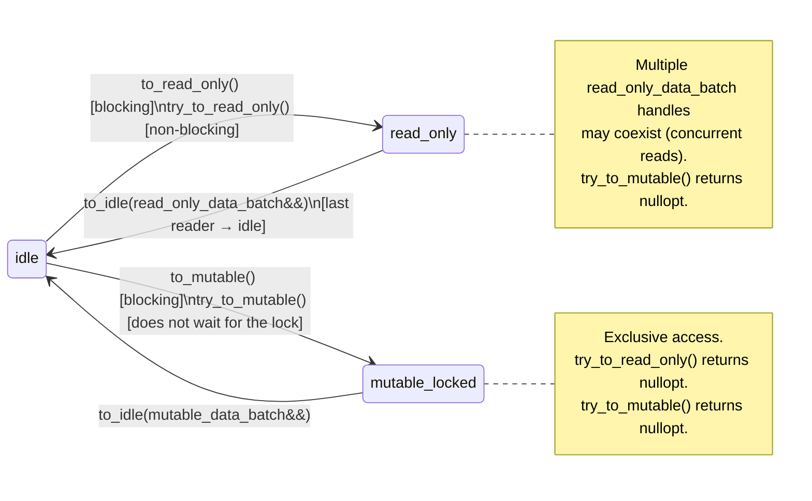

## data_batch State Transitions

This document is the complete reference for how a `data_batch` moves between lifecycle states
and which methods trigger each transition. State changes are enforced by a `std::shared_mutex`.
`_state` is an advisory, relaxed-atomic snapshot of the lock state: under concurrent reader
acquire/release it can briefly disagree with `get_read_only_count()`, so don't use `get_state()`
for synchronization.

### States

| State | Description |
|-------|-------------|
| `idle` | No active locks. The batch is available for reading, mutation, or representation conversion. |
| `read_only` | One or more `read_only_data_batch` shared locks are active (`_read_only_count > 0`). Concurrent readers allowed; exclusive access blocked. |
| `mutable_locked` | One `mutable_data_batch` exclusive lock is active. No concurrent readers. Full read/write access to the data representation. |

### Accessor Classes

Data is only accessible through RAII accessor objects; the idle `shared_ptr<data_batch>` grants
no access to the underlying data.

| Class | Lock type | Copyable | Notes |
|-------|-----------|----------|-------|
| `read_only_data_batch` | Shared (`std::shared_lock`) | Yes — each copy acquires a new shared lock | `_read_only_count` increments per instance |
| `mutable_data_batch` | Exclusive (`std::unique_lock`) | No | Only one can exist at a time |

### Allowed Transitions

#### Non-static (via `shared_from_this` — caller's `shared_ptr` is NOT consumed)

| From | To | Method | Blocking |
|------|----|--------|----------|
| `idle` | `read_only` | `to_read_only()` | Yes — blocks until shared lock available |
| `idle` | `read_only` | `try_to_read_only()` | No — returns `std::nullopt` if exclusive lock held |
| `idle` | `mutable_locked` | `to_mutable()` | Yes — waits for recorded reader events, then blocks until exclusive lock available |
| `idle` | `mutable_locked` | `try_to_mutable()` | No — returns `std::nullopt` if any lock held or a recorded reader event is pending (may wait on the reader-event mutex while another `to_mutable()` synchronizes GPU reader events) |

#### Static (consume accessor via `&&` — source is left null)

| From | To | Method | Blocking | Notes |
|------|----|--------|----------|-------|
| `read_only` | `idle` | `to_idle(read_only_data_batch&&)` | No | Returns `shared_ptr<const data_batch>`; state becomes `idle` when last reader releases |
| `mutable_locked` | `idle` | `to_idle(mutable_data_batch&&)` | No | Releases exclusive lock; returns `shared_ptr<data_batch>` |

Destroying an accessor releases its lock the same way. If that accessor holds the last
`shared_ptr` to the batch, the batch is destroyed too, and its destructor waits for any
outstanding recorded reader events.

### Disallowed / Non-Transitions

- `try_to_read_only()` returns `std::nullopt` when a `mutable_data_batch` is active (exclusive lock held).
- `try_to_mutable()` returns `std::nullopt` when any lock is held (shared or exclusive), or when
  a reader event recorded via `read_only_data_batch::record_reader_event()` has not completed.
- There is no direct `read_only` ↔ `mutable_locked` transition. Release the accessor (via
  `to_idle()` or destruction) and acquire the other one.
- Accessors are not reentrant. Calling `to_read_only()` or `to_mutable()` on a batch while the
  same thread already holds an accessor for it is undefined behavior under `std::shared_mutex`;
  for example, `to_mutable()` while holding a `read_only_data_batch` deadlocks. Release the
  accessor first.
- The non-static transition methods (`to_read_only()`, `to_mutable()`, `try_to_read_only()`,
  `try_to_mutable()`) use `shared_from_this()`, which throws `std::bad_weak_ptr` on a batch not
  managed by `shared_ptr`. The constructor is private, so batches are created with
  `data_batch::make()`, which returns a `shared_ptr`.

### Subscriber Counting

Independent of the locking model, a batch maintains an atomic subscriber interest count:

| Method | Effect |
|--------|--------|
| `subscribe()` | Atomically increments `_subscriber_count` |
| `unsubscribe()` | Atomically decrements; throws `std::runtime_error` if already zero |
| `get_subscriber_count()` | Returns current count (lock-free) |
| `get_read_only_count()` | Returns `_read_only_count` — number of active `read_only_data_batch` instances (lock-free) |
| `get_state()` | Returns a best-effort snapshot of `batch_state` (lock-free, `memory_order_relaxed`; advisory only) |

### Diagram

