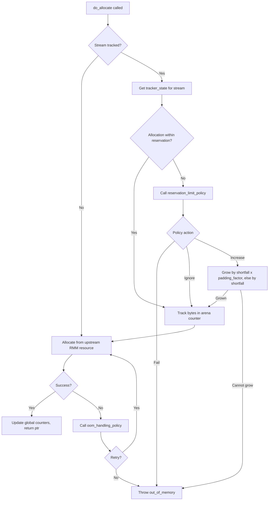

# Memory Management

A deep dive into cuCascade's three-tier memory system, reservation model, and tier-specific allocators.

## Table of Contents

- [Overview](#overview)
- [Memory Tiers](#memory-tiers)
- [Memory Spaces](#memory-spaces)
- [Reservation System](#reservation-system)
  - [Requesting Reservations](#requesting-reservations)
  - [Reserved Arenas](#reserved-arenas)
  - [Reservation Limit Policies](#reservation-limit-policies)
  - [Reservation Lifecycle](#reservation-lifecycle)
- [GPU Memory Management](#gpu-memory-management)
  - [Per-Stream vs Per-Thread Tracking](#per-stream-vs-per-thread-tracking)
  - [Allocation Flow](#allocation-flow)
  - [OOM Handling](#oom-handling)
- [Host Memory Management](#host-memory-management)
  - [Block-Based Allocation](#block-based-allocation)
  - [Pool Expansion](#pool-expansion)
  - [Multi-Block Allocations](#multi-block-allocations)
- [Disk Memory Management](#disk-memory-management)
- [Downgrade and Upgrade Triggers](#downgrade-and-upgrade-triggers)
- [Notification System](#notification-system)
- [Stream Pool](#stream-pool)
- [Key Source Files](#key-source-files)

---

## Overview

The memory module is the foundation of cuCascade. It manages a three-tier memory hierarchy (GPU, HOST, DISK) using **reservation-based allocation** -- callers must reserve memory before allocating, preventing oversubscription and enabling predictable memory management under pressure.

The key abstraction is the `memory_space`, which represents a single memory location (one GPU device, one NUMA host node, or one disk mount). Each memory space has its own allocator, reservation tracking, and downgrade thresholds.

## Memory Tiers

```
┌─────────────────┐
│   GPU (Tier 0)  │  Fastest, smallest capacity
│   Device VRAM   │  reservation_aware_resource_adaptor
├─────────────────┤
│  HOST (Tier 1)  │  Medium speed, medium capacity
│  Pinned CPU RAM │  fixed_size_host_memory_resource
├─────────────────┤
│  DISK (Tier 2)  │  Slowest, largest capacity
│   NVMe / SSD    │  disk_access_limiter
└─────────────────┘
```

| Property | GPU | HOST | DISK |
|----------|-----|------|------|
| `Tier` enum value | `GPU` (0) | `HOST` (1) | `DISK` (2) |
| Backing store | Device VRAM | NUMA-pinned CPU RAM | Filesystem |
| Typical capacity | 8-80 GB | 64-512 GB | 1+ TB |
| Allocator type | `reservation_aware_resource_adaptor` | `fixed_size_host_memory_resource` | `disk_access_limiter` |
| Default allocation | RMM `cuda_async_memory_resource` | NUMA-pinned blocks (1 MB each) | Reservation tracking only |
| Per-stream tracking | Yes | No | No |
| Growable reservations | Yes | Yes | No |
| Upstream resource | RMM async pool | `numa_region_pinned_host_memory_resource` | `null_device_memory_resource` |

Each tier is identified by a `memory_space_id` combining `(Tier, device_id)`. For example:
- `(GPU, 0)` -- first GPU
- `(HOST, 1)` -- host memory on NUMA node 1
- `(DISK, 0)` -- first disk mount

## Memory Spaces

A `memory_space` (defined in `include/cucascade/memory/memory_space.hpp`) is a non-copyable, non-movable container for a single memory location. It is constructed from a tier-specific config struct:

```cpp
// Created internally by memory_reservation_manager
memory_space gpu_space(gpu_memory_space_config{
    .device_id = 0,
    .reservation_limit_fraction = 0.85,
    .downgrade_trigger_fraction = 0.85,
    .downgrade_stop_fraction = 0.65,
    .memory_capacity = 8ULL << 30,  // 8 GB
    .per_stream_reservation = true
});
```

Each memory space holds:

- **Default allocator** (`cuda::mr::any_resource<cuda::mr::device_accessible>`) -- the underlying memory resource
- **Reservation allocator** (variant of GPU/HOST/DISK types) -- wraps the default allocator with reservation tracking
- **Stream pool** (`rmm::cuda_stream_pool`, GPU spaces only) -- pre-allocated CUDA streams for async operations
- **I/O backend** (`shared_ptr<idisk_io_backend>`, DISK spaces only) -- reads and writes the tier's files
- **Notification channel** (`shared_ptr<notification_channel>`) -- signals when reservations are freed
- **Thresholds** -- capacity, reservation limit, downgrade trigger, downgrade stop

Key methods:

| Method | Description |
|--------|-------------|
| `make_reservation(size)` | Reserve `size` bytes, blocking until a reservation in this space is released; returns `nullptr` on shutdown, or a possibly smaller `make_reservation_upto(size)` result when no reservations remain to wait for |
| `make_reservation_or_null(size)` | Create reservation or return null if unavailable |
| `make_reservation_upto(size)` | Create reservation for as much as available (up to `size`) |
| `acquire_stream()` | Get a CUDA stream from the pool (GPU only; throws otherwise) |
| `get_io_backend()` | The DISK space's `idisk_io_backend` (DISK only; throws otherwise) |
| `should_downgrade_memory()` | True if the bytes in use (`capacity - get_available_memory()`) are at least the downgrade trigger threshold |
| `should_stop_downgrading_memory()` | True if the bytes in use are at most the downgrade stop threshold |
| `get_available_memory()` | Remaining allocatable memory |

---

## Reservation System

### Requesting Reservations

`memory_reservation_manager::request_reservation()` selects a target memory space using the **Strategy pattern** (reservations can also be made directly on a `memory_space`):

```cpp
auto manager = memory_reservation_manager(configs);

// Strategy 1: Any GPU
auto res = manager.request_reservation(any_memory_space_in_tier(Tier::GPU), 1ULL << 30);

// Strategy 2: Specific NUMA node
auto res = manager.request_reservation(specific_memory_space(Tier::HOST, 0), 2ULL << 30);

// Strategy 3: Try GPU first, fall back to HOST
auto res = manager.request_reservation(
    any_memory_space_in_tiers({Tier::GPU, Tier::HOST}), 512ULL << 20);
```

Most strategies probe every candidate with the non-blocking `make_reservation_or_null()` first. If none can reserve right away, or if the strategy is strongly ordered (`specific_memory_space`, `any_memory_space_in_tier_with_preference`), the manager calls the blocking `memory_space::make_reservation()` on the first candidate (later candidates are reached only if an earlier one is shut down). It waits on that space's `notification_channel` until a reservation in the same space is released; a reservation released in a different memory space does not wake it.

`any_memory_space_to_downgrade` and `any_memory_space_to_upgrade` are currently stubs that return no candidates, so `request_reservation()` with either of them never returns. Likewise, after `shutdown()` a request that cannot be satisfied immediately never returns: `memory_space::make_reservation()` returns `nullptr` instead of waiting, and `request_reservation()` then waits on a condition variable that is never signalled.

### Reserved Arenas

Each tier has its own `reserved_arena` subclass:

| Arena Type | Tier | Key Feature |
|-----------|------|-------------|
| `device_reserved_arena` | GPU | `atomic_bounded_counter` for per-stream allocation tracking |
| `chunked_reserved_area` | HOST | UUID-based identity, maps to block allocations |
| `disk_reserved_arena` | DISK | Mount path for file-based storage, no grow/shrink |

### Reservation Limit Policies

When an allocation within a stream exceeds its reservation, a `reservation_limit_policy` decides what happens:

```cpp
// Default (make_default_reservation_limit_policy()): allow over-reservation silently
auto policy = std::make_unique<ignore_reservation_limit_policy>();

// Strict limits: throw on over-reservation
auto policy = std::make_unique<fail_reservation_limit_policy>();

// Auto-grow: grow the reservation by the shortfall times padding_factor
auto policy = std::make_unique<increase_reservation_limit_policy>(
    1.25,   // padding_factor
    false   // allow_beyond_limit (currently ignored: growth is always bounded by the reservation limit)
);
```

### Reservation Lifecycle

```
1. REQUEST    manager.request_reservation(strategy, size)
                 └─> strategy selects memory_space
                 └─> memory_space creates reserved_arena
                 └─> returns unique_ptr<reservation>

2. USE        Allocate memory within the reservation's memory space
                 └─> allocator checks reservation limits
                 └─> policy handles over-reservation

3. RELEASE    reservation goes out of scope (RAII)
                 └─> arena destructor frees reserved bytes
                 └─> notification_channel signals waiters
                 └─> blocked memory_space::make_reservation() calls retry
```

---

## GPU Memory Management

**File**: `include/cucascade/memory/reservation_aware_resource_adaptor.hpp`

The `reservation_aware_resource_adaptor` wraps an upstream `rmm::device_async_resource_ref` (by default an `rmm::mr::cuda_async_memory_resource`) and adds:

1. **Global allocation tracking** -- total allocated bytes across all streams
2. **Per-stream reservation enforcement** -- each stream has its own reservation and policy
3. **Memory limit enforcement** -- hard cap on total allocations
4. **OOM handling** -- pluggable retry policies
5. **Pool identity** -- nullable borrowed access to the CUDA pool known to back the upstream resource

### CUDA Pool Peer Access

`reservation_aware_resource_adaptor::pool_handle()` returns the adaptor's borrowed pool handle, or
`nullptr` when the upstream pool cannot be discovered. The adaptor does not own or reconfigure
that pool. An explicitly supplied constructor handle must identify the pool that actually backs
upstream allocations before callers use it as access evidence.

`grant_pool_peer_access(pool, owner_device, accessing_device)` configures one pool for one
accessing GPU and reports whether access was granted, unsupported, rejected by bidirectional byte
verification, or failed in the CUDA runtime. The pool must be live, the device IDs must be valid and
visible, and `owner_device` must identify the pool's allocation device. For distinct devices this
is not checked, because CUDA exposes no query for a pool's owning device: a wrong `owner_device`
verifies one device pair and grants access for another. A successful permission
persists until changed through CUDA or the pool is destroyed. It does not promise bandwidth or
prove the route of a later copy. A failed grant leaves existing pool permissions unchanged; any
revocation must be coordinated by the application with other users of that pool. CUDA errors take
precedence over non-error rejections when the two directional probes disagree. Verified peer
results are cached process-wide. `grant_pool_peer_access()` and
the deprecated `disable_peer_access_where_broken()` retry cached CUDA errors;
`probe_peer_dma_works()` and `peer_access_verified()` report false without retrying. The GPU-to-GPU
converter uses the directional probe and host-stages while an error is cached.

`peer_access_verified(owner_device, accessing_device)` exposes the same bidirectional verification
rule without granting access. It returns true for a same-device request or when both directional
probes pass. Applications can use it to gate their own ordinary peer-access setup. A single
`probe_peer_dma_works(src_device, dst_device)` result is directional: the copy is issued on
`dst_device`, verifying that it can pull bytes from `src_device`, not the reverse direction.

Verification copies 64 bytes in each direction between two private memory pools that are granted
to each other and compares the bytes. Pool grants, not ordinary peer access
(`cudaDeviceEnablePeerAccess`), select the copy route for pool allocations, so the result applies to
pools created with the allocation properties of the pool owned by
`rmm::mr::cuda_async_memory_resource` (pinned device memory, no export handle). Pools with other
properties, including managed-memory pools such as the one owned by
`rmm::mr::cuda_async_managed_memory_resource`, are not verified separately. The probe owns every pool, stream, and allocation it uses:
it leaves ordinary peer access and all caller-visible pool permissions unchanged and waits only for
its own stream. The first request that needs verification checks every ordered pair of visible
devices, a few milliseconds per pair, under a process-wide lock. When verification fails,
GPU-to-GPU conversions stage through pinned host memory instead of copying directly.

cuCascade never enables or disables ordinary peer access. Copies of memory that does not come from a
pool, such as `cudaMalloc` allocations, follow the application's own `cudaDeviceEnablePeerAccess`
setting; while it is disabled the CUDA driver uses an indirect route that is correct but may be
slower. An application may enable ordinary peer access itself, but neither the directional probe
nor `peer_access_verified()` separately verifies that non-pool route.

`enable_pool_peer_access_for_all_visible_devices()` is deprecated. It visits every visible peer for
both the supplied pool and the owner's currently selected pool, writes one stderr line per grant
that fails with a CUDA error, and discards other outcomes. Replace it with explicit
`grant_pool_peer_access()` calls for each required pool and accessing device, and check each
returned `pool_peer_access_result`. Only the pools explicitly passed to `grant_pool_peer_access()`
are configured.

`disable_peer_access_where_broken()` is deprecated. Despite its name, it changes neither ordinary
peer access nor caller pool permissions; it reports how many directions failed byte verification, or
-1 when verification could not run, and retries cached CUDA errors. Use `peer_access_verified()` for
a boolean verification check; that query does not count failed directions or retry cached CUDA
errors. Applications must coordinate any access revocation with other users and perform it through
CUDA.

### Per-Stream vs Per-Thread Tracking

The adaptor supports two tracking modes via `AllocationTrackingScope`:

| Mode | Class | Use Case |
|------|-------|----------|
| `PER_STREAM` | `stream_ordered_allocation_tracker` | Default. Tracks via `unordered_map<cudaStream_t, state>`. Thread-safe with mutex. |
| `PER_THREAD` | `ptds_allocation_tracker` | Uses `thread_local` storage. No lock needed. For per-thread-default-stream (PTDS) workflows. |

Each tracked stream has a `stream_ordered_tracker_state` containing:
- A `device_reserved_arena` for the stream's reservation
- A `reservation_limit_policy` for handling over-reservation
- An `oom_handling_policy` for handling allocation failures

### Allocation Flow



### OOM Handling

The `oom_handling_policy` interface provides a hook for custom recovery:

```cpp
class oom_handling_policy {
 public:
    using RetryFunc = std::function<void*(std::size_t, ::cuda::stream_ref)>;

    // Non-virtual; forwards to do_handle_oom()
    void* handle_oom(std::size_t bytes, ::cuda::stream_ref stream,
                     std::exception_ptr eptr, RetryFunc retry_function);

    virtual std::string get_policy_name() const noexcept = 0;

 protected:
    virtual void* do_handle_oom(std::size_t bytes, ::cuda::stream_ref stream,
                                std::exception_ptr eptr, RetryFunc retry_function) = 0;
};
```

Custom policies override `do_handle_oom()` and `get_policy_name()`. The default `throw_on_oom_policy` simply rethrows the exception. Custom policies could spill data to a lower tier and retry.

cuCascade also provides a custom exception `cucascade_out_of_memory` (extending `rmm::out_of_memory`) that includes `requested_bytes` and `global_usage` for diagnostics.

---

## Host Memory Management

**File**: `include/cucascade/memory/fixed_size_host_memory_resource.hpp`

The `fixed_size_host_memory_resource` manages pinned host memory using fixed-size blocks. This design avoids fragmentation and enables predictable allocation patterns.

### Block-Based Allocation

- All allocations are in fixed-size blocks (default: **1 MB**)
- Blocks are pre-allocated in pools from a NUMA-pinned upstream allocator
- A free list tracks available blocks
- All allocations go through `allocate_multiple_blocks()`, which returns a RAII `multiple_blocks_allocation`; the plain `allocate()` throws `rmm::logic_error`

```
Pool 0: [block][block][block]...[block]  (128 blocks = 128 MB)
Pool 1: [block][block][block]...[block]  (128 blocks = 128 MB)
Pool 2: [block][block][block]...[block]  (128 blocks = 128 MB)
Pool 3: [block][block][block]...[block]  (128 blocks = 128 MB)
         └── Free list ──────────────────────────────────────┘
```

Default configuration:
- `block_size`: 1 MB (`1 << 20`)
- `pool_size`: 128 blocks per pool
- `initial_number_pools`: 4 (512 MB initial)

### Pool Expansion

When the free list is empty:
1. A new pool of `pool_size` blocks is allocated from the upstream NUMA-pinned resource
2. Blocks are added to the free list
3. The pool pointer is tracked for cleanup

### Multi-Block Allocations

For data larger than one block, `allocate_multiple_blocks()` returns a RAII `multiple_blocks_allocation`:

```cpp
// Allocate 10 MB (10 blocks of 1 MB each)
auto alloc = host_mr.allocate_multiple_blocks(10ULL << 20, reservation_ptr);

// Access blocks
for (size_t i = 0; i < alloc->size(); i++) {
    std::span<std::byte> block = alloc->at(i);
    // block.size() == 1 MB
}
// Blocks auto-returned to free list on destruction
```

---

## Disk Memory Management

**File**: `include/cucascade/memory/disk_access_limiter.hpp`

The disk tier uses `disk_access_limiter` for **reservation tracking only** -- it doesn't allocate actual storage. Instead, it tracks how much disk space is reserved and enforces capacity limits.

- `disk_reserved_arena` stores a mount path (base filename) for the reservation
- No `grow_by()` or `shrink_to_fit()` support (reservations are fixed-size)
- Uses `null_device_memory_resource` as the "allocator" (returns `nullptr`)
- File I/O goes through the DISK `memory_space`'s `idisk_io_backend` (`get_io_backend()`). Spaces
  created by `memory_reservation_manager` always use the pipeline backend; a different backend can
  be chosen only by constructing a `memory_space` directly with
  `memory_space(disk_memory_space_config, shared_ptr<idisk_io_backend>)`. The built-in
  GPU/HOST <-> DISK converters use it to write and read files under the space's mount path.

---

## Downgrade and Upgrade Triggers

Each memory space has configurable thresholds that control when data should move between tiers:

```cpp
gpu_memory_space_config config;
config.downgrade_trigger_fraction = 0.85;
config.downgrade_stop_fraction = 0.65;
```

Both fractions are multiplied by `memory_capacity` and compared against the bytes in use,
`memory_capacity - get_available_memory()` (the bytes reserved or allocated in the space).
`should_downgrade_memory()` is true when usage is at least `downgrade_trigger_fraction *
memory_capacity`, `should_stop_downgrading_memory()` is true when it is at most
`downgrade_stop_fraction * memory_capacity`, and `get_amount_to_downgrade()` returns how far usage
is above the stop threshold.

The application queries these thresholds:

```cpp
if (gpu_space.should_downgrade_memory()) {
    size_t amount = gpu_space.get_amount_to_downgrade();
    // Move 'amount' bytes worth of data from GPU to HOST
}

if (!gpu_space.should_stop_downgrading_memory()) {
    // Continue downgrading more batches
}
```

The gap between the trigger and stop thresholds creates a **hysteresis band** that prevents thrashing -- data isn't immediately moved back when usage briefly drops below the trigger.

---

## Notification System

**File**: `include/cucascade/memory/notification_channel.hpp`

The `notification_channel` enables efficient waiting for memory to become available:

```
tier allocator (GPU/HOST/DISK)              memory_space
         |                                            |
         | reserve() creates arena with               |
         | event_notifier attached                    |
         |                                            |
         | ... time passes ...                        | make_reservation()
         |                                            | blocks in notification_channel::wait()
         | reservation released                       |
         | -> arena destructor                        |
         | -> notify_on_exit::~notify_on_exit()       |
         | -> event_notifier::post()                  |
         | -> notification_channel::notify()          |
         |                                  --------> | wait() returns NOTIFIED
         |                                            | retries reservation request
```

Key types:
- `notification_channel` -- shared channel with mutex/CV, supports `wait()` and `shutdown()`
- `event_notifier` -- lightweight handle whose `post()` calls `notify()` on the channel; it counts as an active notifier until destroyed
- `notify_on_exit` -- RAII wrapper that calls the notifier's `post()` in its destructor
- `wait_status` -- `IDLE` (no active notifiers left), `NOTIFIED` (reservation freed), `SHUTDOWN` (system stopping)

---

## Stream Pool

Each GPU `memory_space` owns an `rmm::cuda_stream_pool` of **16 non-blocking streams**.
`memory_space::acquire_stream()` returns a `cuda::stream_ref` from that pool. The streams are
shared, not lent exclusively, and nothing is returned to the pool. HOST and DISK spaces have no
stream pool, and `acquire_stream()` throws for them.

**File**: `include/cucascade/memory/stream_pool.hpp`

For exclusive use, the standalone `exclusive_stream_pool` pre-allocates CUDA streams (default:
16) and lends them via RAII `borrowed_stream` handles. `memory_space` does not use it:

```cpp
auto stream = pool.acquire_stream(exclusive_stream_pool::stream_acquire_policy::BLOCK);
// Use stream for GPU operations
// stream auto-returned to pool when handle goes out of scope
```

| Policy | Behavior |
|--------|----------|
| `BLOCK` | Wait on condition variable until a stream is available |
| `GROW` | Create a new stream if the pool is empty |

---

## Key Source Files

| File | Purpose |
|------|---------|
| `include/cucascade/memory/common.hpp` | `Tier` enum, `memory_space_id`, factory functions |
| `include/cucascade/memory/config.hpp` | `gpu_memory_space_config`, `host_memory_space_config`, `disk_memory_space_config` |
| `include/cucascade/memory/memory_reservation_manager.hpp` | Central coordinator, request strategies |
| `include/cucascade/memory/memory_space.hpp` | Per-location memory container |
| `include/cucascade/memory/memory_reservation.hpp` | `reservation`, `reserved_arena`, limit policies |
| `include/cucascade/memory/reservation_aware_resource_adaptor.hpp` | GPU allocator with per-stream tracking |
| `include/cucascade/memory/fixed_size_host_memory_resource.hpp` | Block-based pinned host allocator |
| `include/cucascade/memory/disk_access_limiter.hpp` | Disk tier reservation tracker |
| `include/cucascade/memory/notification_channel.hpp` | Cross-reservation signaling |
| `include/cucascade/memory/stream_pool.hpp` | `exclusive_stream_pool` with RAII borrowing |
| `include/cucascade/memory/oom_handling_policy.hpp` | OOM handling strategies |
| `include/cucascade/memory/error.hpp` | `MemoryError` enum, `cucascade_out_of_memory` exception |
| `include/cucascade/memory/numa_region_pinned_host_allocator.hpp` | NUMA-aware pinned host allocation |
| `include/cucascade/memory/column_metadata.hpp` | `column_metadata` shared by host and disk table layouts |
| `include/cucascade/cudf/host_table.hpp` | `host_table_allocation` for direct-copy host representations |
| `include/cucascade/cudf/host_table_packed.hpp` | `host_table_packed_allocation` for packed (cudf::pack) host representations |
| `include/cucascade/memory/null_device_memory_resource.hpp` | No-op resource for disk tier |
| `include/cucascade/data/disk_io_backend.hpp` | `idisk_io_backend` interface used by DISK memory spaces |
| `include/cucascade/utils/atomics.hpp` | `atomic_peak_tracker`, `atomic_bounded_counter` |
