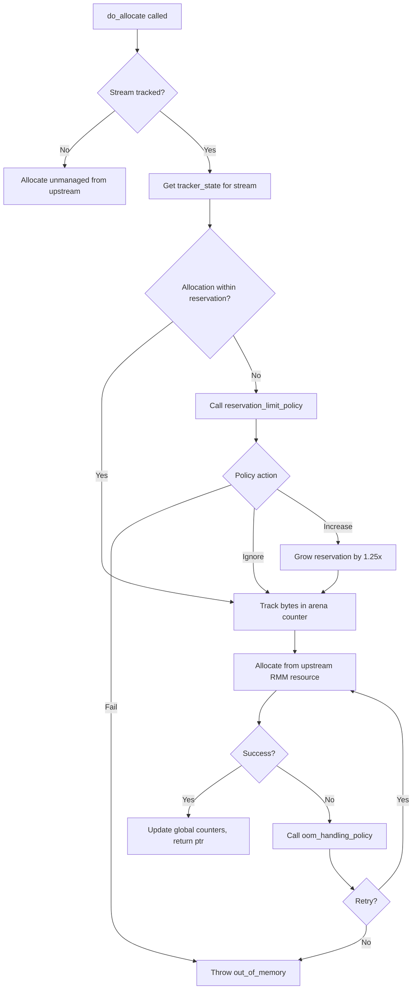

# Memory Management

A deep dive into cuCascade's three-tier memory system, reservation model, and tier-specific allocators.

## Table of Contents

- [Overview](#overview)
- [Memory Tiers](#memory-tiers)
- [Memory Spaces](#memory-spaces)
- [Reservation System](#reservation-system)
  - [Requesting Reservations](#requesting-reservations)
  - [Reserved Arenas](#reserved-arenas)
  - [Reservation Limit Policies](#reservation-limit-policies)
  - [Reservation Lifecycle](#reservation-lifecycle)
- [GPU Memory Management](#gpu-memory-management)
  - [Per-Stream vs Per-Thread Tracking](#per-stream-vs-per-thread-tracking)
  - [Allocation Flow](#allocation-flow)
  - [OOM Handling](#oom-handling)
- [Host Memory Management](#host-memory-management)
  - [Block-Based Allocation](#block-based-allocation)
  - [Pool Expansion](#pool-expansion)
  - [Multi-Block Allocations](#multi-block-allocations)
- [Pinned Host Pool](#pinned-host-pool)
  - [Backing and Configuration](#backing-and-configuration)
  - [Byte Limit](#byte-limit)
  - [Allocation Rules](#allocation-rules)
  - [Stream-Ordering and Host-Access Contract](#stream-ordering-and-host-access-contract)
  - [Errors](#errors)
  - [Lifetime](#lifetime)
  - [Guarantees](#guarantees)
- [Disk Memory Management](#disk-memory-management)
- [Downgrade and Upgrade Triggers](#downgrade-and-upgrade-triggers)
- [Notification System](#notification-system)
- [Stream Pool](#stream-pool)
- [Key Source Files](#key-source-files)

---

## Overview

The memory module is the foundation of cuCascade. It manages a three-tier memory hierarchy (GPU, HOST, DISK) using **reservation-based allocation** -- callers must reserve memory before allocating, preventing oversubscription and enabling predictable memory management under pressure.

The key abstraction is the `memory_space`, which represents a single memory location (one GPU device, one NUMA host node, or one disk mount). Each memory space has its own allocator, reservation tracking, and downgrade thresholds.

## Memory Tiers

```
┌─────────────────┐
│   GPU (Tier 0)  │  Fastest, smallest capacity
│   Device VRAM   │  reservation_aware_resource_adaptor
├─────────────────┤
│  HOST (Tier 1)  │  Medium speed, medium capacity
│  Pinned CPU RAM │  fixed_size_host_memory_resource
├─────────────────┤
│  DISK (Tier 2)  │  Slowest, largest capacity
│   NVMe / SSD    │  disk_access_limiter
└─────────────────┘
```

| Property | GPU | HOST | DISK |
|----------|-----|------|------|
| `Tier` enum value | `GPU` (0) | `HOST` (1) | `DISK` (2) |
| Backing store | Device VRAM | NUMA-pinned CPU RAM | Filesystem |
| Typical capacity | 8-80 GB | 64-512 GB | 1+ TB |
| Allocator type | `reservation_aware_resource_adaptor` | `fixed_size_host_memory_resource` | `disk_access_limiter` |
| Default allocation | RMM `cuda_async_memory_resource` | NUMA-pinned blocks (1 MB each) | Reservation tracking only |
| Per-stream tracking | Yes | No | No |
| Growable reservations | Yes | Yes | No |
| Upstream resource | RMM async pool | `numa_region_pinned_host_memory_resource` | `null_device_memory_resource` |

Each tier is identified by a `memory_space_id` combining `(Tier, device_id)`. For example:
- `(GPU, 0)` -- first GPU
- `(HOST, 1)` -- host memory on NUMA node 1
- `(DISK, 0)` -- first disk mount

## Memory Spaces

A `memory_space` (defined in `include/cucascade/memory/memory_space.hpp`) is a non-copyable, non-movable container for a single memory location. It is constructed from a tier-specific config struct:

```cpp
// Created internally by memory_reservation_manager
memory_space gpu_space(gpu_memory_space_config{
    .device_id = 0,
    .reservation_limit_fraction = 0.85,
    .downgrade_trigger_fraction = 0.85,
    .downgrade_stop_fraction = 0.65,
    .memory_capacity = 8ULL << 30,  // 8 GB
    .per_stream_reservation = true
});
```

Each memory space holds:

- **Default allocator** (`rmm::mr::device_memory_resource*`) -- the underlying memory resource
- **Reservation allocator** (variant of GPU/HOST/DISK types) -- wraps the default allocator with reservation tracking
- **Stream pool** (`exclusive_stream_pool`) -- pre-allocated CUDA streams for async operations
- **Notification channel** (`shared_ptr<notification_channel>`) -- signals when reservations are freed
- **Thresholds** -- capacity, reservation limit, downgrade trigger, downgrade stop

Key methods:

| Method | Description |
|--------|-------------|
| `make_reservation(size)` | Create exact-size reservation, blocks if at limit |
| `make_reservation_or_null(size)` | Create reservation or return null if unavailable |
| `make_reservation_upto(size)` | Create reservation for as much as available (up to `size`) |
| `acquire_stream()` | Borrow a CUDA stream from the pool |
| `should_downgrade_memory()` | True if usage exceeds downgrade trigger threshold |
| `should_stop_downgrading_memory()` | True if usage is below downgrade stop threshold |
| `get_available_memory()` | Remaining allocatable memory |

---

## Reservation System

### Requesting Reservations

All reservations flow through `memory_reservation_manager::request_reservation()`, which uses the **Strategy pattern** to select a target memory space:

```cpp
auto manager = memory_reservation_manager(configs);

// Strategy 1: Any GPU
auto res = manager.request_reservation(any_memory_space_in_tier(Tier::GPU), 1ULL << 30);

// Strategy 2: Specific NUMA node
auto res = manager.request_reservation(specific_memory_space(Tier::HOST, 0), 2ULL << 30);

// Strategy 3: Try GPU first, fall back to HOST
auto res = manager.request_reservation(
    any_memory_space_in_tiers({Tier::GPU, Tier::HOST}), 512ULL << 20);

// Strategy 4: Downgrade from GPU to HOST
auto res = manager.request_reservation(
    any_memory_space_to_downgrade(gpu_space_id, Tier::HOST), data_size);
```

If no space can satisfy the request, the manager waits on a condition variable until a reservation is released somewhere in the system.

### Reserved Arenas

Each tier has its own `reserved_arena` subclass:

| Arena Type | Tier | Key Feature |
|-----------|------|-------------|
| `device_reserved_arena` | GPU | `atomic_bounded_counter` for per-stream allocation tracking |
| `chunked_reserved_area` | HOST | UUID-based identity, maps to block allocations |
| `disk_reserved_arena` | DISK | Mount path for file-based storage, no grow/shrink |

### Reservation Limit Policies

When an allocation within a stream exceeds its reservation, a `reservation_limit_policy` decides what happens:

```cpp
// Default: throw on over-reservation
auto policy = std::make_unique<fail_reservation_limit_policy>();

// Soft limits: allow over-reservation silently
auto policy = std::make_unique<ignore_reservation_limit_policy>();

// Auto-grow: increase reservation by 1.25x
auto policy = std::make_unique<increase_reservation_limit_policy>(
    1.25,   // padding_factor
    false   // allow_beyond_limit
);
```

### Reservation Lifecycle

```
1. REQUEST    manager.request_reservation(strategy, size)
                 └─> strategy selects memory_space
                 └─> memory_space creates reserved_arena
                 └─> returns unique_ptr<reservation>

2. USE        Allocate memory within the reservation's memory space
                 └─> allocator checks reservation limits
                 └─> policy handles over-reservation

3. RELEASE    reservation goes out of scope (RAII)
                 └─> arena destructor frees reserved bytes
                 └─> notification_channel signals waiters
                 └─> blocked request_reservation() calls unblock
```

---

## GPU Memory Management

**File**: `include/cucascade/memory/reservation_aware_resource_adaptor.hpp`

The `reservation_aware_resource_adaptor` wraps an RMM `device_memory_resource` (typically `cuda_async_memory_resource`) and adds:

1. **Global allocation tracking** -- total allocated bytes across all streams
2. **Per-stream reservation enforcement** -- each stream has its own reservation and policy
3. **Memory limit enforcement** -- hard cap on total allocations
4. **OOM handling** -- pluggable retry policies
5. **Pool identity** -- nullable borrowed access to the CUDA pool known to back the upstream resource

### CUDA Pool Peer Access

`reservation_aware_resource_adaptor::pool_handle()` returns the adaptor's borrowed pool handle, or
`nullptr` when the upstream pool cannot be discovered. The adaptor does not own or reconfigure
that pool. An explicitly supplied constructor handle must identify the pool that actually backs
upstream allocations before callers use it as access evidence.

`grant_pool_peer_access(pool, owner_device, accessing_device)` configures one pool for one
accessing GPU and reports whether access was granted, unsupported, rejected by bidirectional byte
verification, or failed in the CUDA runtime. The pool must be live, the device IDs must be valid and
visible, and `owner_device` must identify the pool's allocation device. For distinct devices this
is not checked, because CUDA exposes no query for a pool's owning device: a wrong `owner_device`
verifies one device pair and grants access for another. A successful permission
persists until changed through CUDA or the pool is destroyed. It does not promise bandwidth or
prove the route of a later copy. A failed grant leaves existing pool permissions unchanged; any
revocation must be coordinated by the application with other users of that pool. CUDA errors take
precedence over non-error rejections when the two directional probes disagree. Verified peer
results are cached process-wide. `grant_pool_peer_access()` and
the deprecated `disable_peer_access_where_broken()` retry cached CUDA errors;
`probe_peer_dma_works()` and `peer_access_verified()` report false without retrying. The GPU-to-GPU
converter uses the directional probe and host-stages while an error is cached.

`peer_access_verified(owner_device, accessing_device)` exposes the same bidirectional verification
rule without granting access. It returns true for a same-device request or when both directional
probes pass. Applications can use it to gate their own ordinary peer-access setup. A single
`probe_peer_dma_works(src_device, dst_device)` result is directional: the copy is issued on
`dst_device`, verifying that it can pull bytes from `src_device`, not the reverse direction.

Verification copies 64 bytes in each direction between two private memory pools that are granted
to each other and compares the bytes. Pool grants, not ordinary peer access
(`cudaDeviceEnablePeerAccess`), select the copy route for pool allocations, so the result applies to
pools created with the allocation properties of the pool owned by
`rmm::mr::cuda_async_memory_resource` (pinned device memory, no export handle). Pools with other
properties, including managed-memory pools such as the one owned by
`rmm::mr::cuda_async_managed_memory_resource`, are not verified separately. The probe owns every pool, stream, and allocation it uses:
it leaves ordinary peer access and all caller-visible pool permissions unchanged and waits only for
its own stream. The first request that needs verification checks every ordered pair of visible
devices, a few milliseconds per pair, under a process-wide lock. When verification fails,
GPU-to-GPU conversions stage through pinned host memory instead of copying directly.

cuCascade never enables or disables ordinary peer access. Copies of memory that does not come from a
pool, such as `cudaMalloc` allocations, follow the application's own `cudaDeviceEnablePeerAccess`
setting; while it is disabled the CUDA driver uses an indirect route that is correct but may be
slower. An application may enable ordinary peer access itself, but neither the directional probe
nor `peer_access_verified()` separately verifies that non-pool route.

`enable_pool_peer_access_for_all_visible_devices()` is deprecated. It visits every visible peer for
both the supplied pool and the owner's currently selected pool, writes one stderr line per grant
that fails with a CUDA error, and discards other outcomes. Replace it with explicit
`grant_pool_peer_access()` calls for each required pool and accessing device, and check each
returned `pool_peer_access_result`. Only the pools explicitly passed to `grant_pool_peer_access()`
are configured.

`disable_peer_access_where_broken()` is deprecated. Despite its name, it changes neither ordinary
peer access nor caller pool permissions; it reports how many directions failed byte verification, or
-1 when verification could not run, and retries cached CUDA errors. Use `peer_access_verified()` for
a boolean verification check; that query does not count failed directions or retry cached CUDA
errors. Applications must coordinate any access revocation with other users and perform it through
CUDA.

### Per-Stream vs Per-Thread Tracking

The adaptor supports two tracking modes via `AllocationTrackingScope`:

| Mode | Class | Use Case |
|------|-------|----------|
| `PER_STREAM` | `stream_ordered_allocation_tracker` | Default. Tracks via `unordered_map<cudaStream_t, state>`. Thread-safe with mutex. |
| `PER_THREAD` | `ptds_allocation_tracker` | Uses `thread_local` storage. No lock needed. For per-thread-default-stream (PTDS) workflows. |

Each tracked stream has a `stream_ordered_tracker_state` containing:
- A `device_reserved_arena` for the stream's reservation
- A `reservation_limit_policy` for handling over-reservation
- An `oom_handling_policy` for handling allocation failures

### Allocation Flow



### OOM Handling

The `oom_handling_policy` interface provides a hook for custom recovery:

```cpp
struct oom_handling_policy {
    using RetryFunc = std::function<void*(std::size_t, ::cuda::stream_ref)>;

    void* handle_oom(std::size_t bytes, ::cuda::stream_ref stream,
                     std::exception_ptr eptr, RetryFunc retry_function);
};
```

The default `throw_on_oom_policy` simply rethrows the exception. Custom policies could spill data to a lower tier and retry.

cuCascade also provides a custom exception `cucascade_out_of_memory` (extending `rmm::out_of_memory`) that includes `requested_bytes` and `global_usage` for diagnostics.

---

## Host Memory Management

**File**: `include/cucascade/memory/fixed_size_host_memory_resource.hpp`

The `fixed_size_host_memory_resource` manages pinned host memory using fixed-size blocks. This design avoids fragmentation and enables predictable allocation patterns.

### Block-Based Allocation

- All allocations are in fixed-size blocks (default: **1 MB**)
- Blocks are pre-allocated in pools from a NUMA-pinned upstream allocator
- A free list tracks available blocks
- Allocations that need more than one block use `multiple_blocks_allocation`

```
Pool 0: [block][block][block]...[block]  (128 blocks = 128 MB)
Pool 1: [block][block][block]...[block]  (128 blocks = 128 MB)
Pool 2: [block][block][block]...[block]  (128 blocks = 128 MB)
Pool 3: [block][block][block]...[block]  (128 blocks = 128 MB)
         └── Free list ──────────────────────────────────────┘
```

Default configuration:
- `block_size`: 1 MB (`1 << 20`)
- `pool_size`: 128 blocks per pool
- `initial_number_pools`: 4 (512 MB initial)

### Pool Expansion

When the free list is empty:
1. A new pool of `pool_size` blocks is allocated from the upstream NUMA-pinned resource
2. Blocks are added to the free list
3. The pool pointer is tracked for cleanup

### Multi-Block Allocations

For data larger than one block, `allocate_multiple_blocks()` returns a RAII `multiple_blocks_allocation`:

```cpp
// Allocate 10 MB (10 blocks of 1 MB each)
auto alloc = host_mr.allocate_multiple_blocks(10ULL << 20, reservation_ptr);

// Access blocks
for (size_t i = 0; i < alloc->size(); i++) {
    std::span<std::byte> block = alloc->at(i);
    // block.size() == 1 MB
}
// Blocks auto-returned to free list on destruction
```

---

## Pinned Host Pool

**File**: `include/cucascade/memory/pinned_host_pool_memory_resource.hpp`

`pinned_host_pool_memory_resource` is a pinned, stream-ordered host memory resource that serves contiguous allocations up to a configured request limit. It is built to be installed as cudf's pinned host memory provider. It is part of the cudf-free core and is not yet used by `memory_space`.

### Backing and Configuration

The memory comes from one CUDA HostNuma memory pool (`cudaMemPool_t`), held through CCCL's `cuda::shared_pinned_memory_pool`. The CUDA driver manages page placement and reuse. Every visible GPU is given access to the pool, and the host may access it directly. On GB10 with driver 580, Compute Sanitizer was observed to report `CUDA API Error: HOST/HOST_NUMA pools are always read-write accessible on the HOST` once per pool, from the `cudaMemPoolSetAccess` call inside CCCL's pool constructor. The call returned success and grants the device access needed for operations such as `cudaMemsetAsync`.

| `pinned_host_pool_config` field | Type | Rule |
|---|---|---|
| `numa_node` | `int` | Required, 0 or more. Machines without NUMA use node 0. |
| `max_pool_bytes` | `std::size_t` | Required, not 0. Sets the per-request limit and the CUDA pool size (see [Byte Limit](#byte-limit)). |

Both fields default to invalid values, so a field left unset throws instead of silently choosing a node or a limit.

`pinned_host_pool_memory_resource` is a copyable handle that inherits `cuda::mr::shared_resource` over `detail::pinned_host_pool_memory_resource_impl`. Copies share one pool and compare equal; handles over different pools compare unequal; the pool is destroyed with the last handle. It declares the `cuda::mr::device_accessible` and `cuda::mr::host_accessible` properties, so it converts to `cuda::mr::any_resource` and `rmm::host_device_async_resource_ref`. Allocation, deallocation and the counters are safe to call from many threads at once, on one handle or across copies. As with `std::shared_ptr`, one handle object must not be assigned to while another thread uses it.

```cpp
using namespace cucascade::memory;

pinned_host_pool_memory_resource pool{pinned_host_pool_config{.numa_node = 0, .max_pool_bytes = 4ull << 30}};
void* p = pool.allocate(stream, 1 << 20, 256);  // stream-ordered on `stream`
pool.deallocate(stream, p, 1 << 20, 256);
```

### Byte Limit

After validating alignment, `allocate` and `allocate_sync` reject a single request larger than `max_pool_bytes` with `rmm::out_of_memory` before calling CUDA. The resource also passes this value to CUDA as the pool's maximum size. The driver has been observed to round the size up when growing the pool, so `reserved_bytes()` may exceed the configured value. Callers that require a hard cap on total backing memory need to account for this driver behavior.

### Allocation Rules

- `allocate(stream, bytes, alignment)` and `deallocate(stream, ptr, bytes, alignment)` run on the caller's stream.
- `allocate_sync(bytes, alignment)` and `deallocate_sync(ptr, bytes, alignment)` run on a private non-blocking stream on device 0 and synchronize it before returning. CCCL's own synchronous calls are never used, because they run on a hidden process-wide stream.
- `alignment` must be a power of two from 1 to 256. Allocation throws `cucascade::logic_error` for invalid alignment. Returned pointers are at least 256-byte aligned.
- With valid alignment, allocating 0 bytes returns `nullptr` and deallocating `nullptr` or 0 bytes is a no-op. Both shortcuts skip the pool operation.
- `deallocate` and `deallocate_sync` are `noexcept`. An invalid alignment there is a debug assertion and is otherwise ignored.
- Calls that reach CUDA on the legacy default stream (`cudaStream_t{}`) or `cudaStreamPerThread` require a current CUDA context on the calling thread. For example, initialize the context with `cudaSetDevice` or `cudaFree(0)`. An explicitly created stream carries its own context.
- `reserved_bytes()` (memory held from the operating system, in use or idle) and `used_bytes()` (memory handed to callers) read the pool's attributes. Synchronize the relevant streams before reading the counters to measure the pool after queued work completes. The driver may reserve more than an allocation asks for. `max_pool_bytes()` returns the configured limit.

### Stream-Ordering and Host-Access Contract

`allocate` and `deallocate` follow CUDA stream ordering without adding synchronization. CUDA may insert stream dependencies when reusing memory.

- After `allocate(stream, ...)`, GPU work on `stream` may use the memory at once. Before the host touches the memory, synchronize `stream` or wait for an event recorded on `stream` after enqueuing the allocation.
- `allocate_sync` returns memory the host can use immediately.
- Before calling `deallocate_sync`, wait for the allocation and all GPU and host uses of the pointer to complete.
- A stream-ordered call may be paired with a synchronous call, in either order, when the rules above hold.
- Memory may be allocated on stream S, used on stream T and freed on stream U. The caller orders T's use after the allocation on S and the free on U after the allocation and every use, for example with events.

### Errors

| Where | Condition | Throws |
|---|---|---|
| Construction | Invalid `pinned_host_pool_config` (checked before any CUDA call) | `cucascade::logic_error` |
| Construction | CUDA initialization failure (for example no visible GPU), no HostNuma pool support, nonexistent NUMA node, failed private stream creation | `cucascade::cuda_error` with the CUDA status and the node |
| `allocate`, `allocate_sync` | Invalid alignment | `cucascade::logic_error` |
| `allocate`, `allocate_sync` | Request larger than `max_pool_bytes` (checked before the driver call) | `rmm::out_of_memory` |
| `allocate`, `allocate_sync` | CUDA status `cudaErrorMemoryAllocation` (the byte limit or host memory is exhausted) | `rmm::out_of_memory` |
| `allocate`, `allocate_sync` | Any other CUDA failure, such as a default-stream call from a thread without a current context | `rmm::bad_alloc` |
| `reserved_bytes`, `used_bytes` | Driver query failure | `cucascade::cuda_error` |
| `deallocate`, `deallocate_sync` | CUDA fails to enqueue the free | No exception. CCCL can assert when its assertions are enabled. |
| `deallocate_sync` | CUDA stream synchronization fails | No exception. cuCascade logs an error and asserts in debug builds. |

The exception type is chosen from the CUDA status code, never from the message. No CCCL exception type reaches callers. An out-of-memory error leaves the pool usable for later requests. Missing HostNuma support and a nonexistent node are not told apart by type, and there is no fallback to another allocator.

### Lifetime

- Submit a free for every allocation before destroying the last handle. Frees may still be queued on a stream. CUDA defers reclaiming the pool until all outstanding allocations have been freed.
- Do not keep handles in static storage, and do not destroy a handle after the CUDA runtime has shut down.

### Guarantees

- **Promised:** page-locked; host-accessible; accessible from each configured device at the same address; allocated by CUDA from a stream-ordered pool.
- **Requested, not guaranteed:** placement on `numa_node`.
- **Never promised:** registered with `cudaHostRegister`; managed; access from unconfigured devices; any particular `cudaPointerGetAttributes` type; zero-filled memory; IPC export.

Every visible GPU is a configured device.

---

## Disk Memory Management

**File**: `include/cucascade/memory/disk_access_limiter.hpp`

The disk tier uses `disk_access_limiter` for **reservation tracking only** -- it doesn't allocate actual storage. Instead, it tracks how much disk space is reserved and enforces capacity limits.

- `disk_reserved_arena` stores a mount path (base filename) for the reservation
- No `grow_by()` or `shrink_to_fit()` support (reservations are fixed-size)
- Uses `null_device_memory_resource` as the "allocator" (returns `nullptr`)
- Actual file I/O is handled by the application layer

---

## Downgrade and Upgrade Triggers

Each memory space has configurable thresholds that control when data should move between tiers:

```cpp
gpu_memory_space_config config;
config.downgrade_trigger_fraction = 0.85;  // Start downgrading at 85% usage
config.downgrade_stop_fraction = 0.65;     // Stop downgrading at 65% usage
```

The application queries these thresholds:

```cpp
if (gpu_space.should_downgrade_memory()) {
    size_t amount = gpu_space.get_amount_to_downgrade();
    // Move 'amount' bytes worth of data from GPU to HOST
}

if (!gpu_space.should_stop_downgrading_memory()) {
    // Continue downgrading more batches
}
```

The gap between trigger (85%) and stop (65%) creates a **hysteresis band** that prevents thrashing -- data isn't immediately moved back when usage briefly drops below the trigger.

---

## Notification System

**File**: `include/cucascade/memory/notification_channel.hpp`

The `notification_channel` enables efficient waiting for memory to become available:

```
reservation_aware_resource_adaptor          memory_reservation_manager
         |                                            |
         | reserve() creates arena with               |
         | event_notifier attached                     |
         |                                            |
         | ... time passes ...                        | request_reservation()
         |                                            | blocks on condition_variable
         | reservation released                       |
         | -> arena destructor                        |
         | -> event_notifier::~event_notifier()       |
         | -> notification_channel::notify()           |
         |                                  --------> | condition_variable wakes up
         |                                            | retries reservation request
```

Key types:
- `notification_channel` -- shared channel with mutex/CV, supports `wait()` and `shutdown()`
- `event_notifier` -- lightweight handle that calls `notify()` on the channel when destroyed
- `notify_on_exit` -- RAII wrapper that invokes the notifier in its destructor
- `wait_status` -- `IDLE` (spurious), `NOTIFIED` (reservation freed), `SHUTDOWN` (system stopping)

---

## Stream Pool

**File**: `include/cucascade/memory/stream_pool.hpp`

The `exclusive_stream_pool` pre-allocates CUDA streams and lends them via RAII `borrowed_stream` handles:

```cpp
auto stream = pool.acquire_stream(stream_acquire_policy::BLOCK);
// Use stream for GPU operations
// stream auto-returned to pool when handle goes out of scope
```

| Policy | Behavior |
|--------|----------|
| `BLOCK` | Wait on condition variable until a stream is available |
| `GROW` | Create a new stream if the pool is empty |

Default pool size: **16 streams** per memory space.

---

## Key Source Files

| File | Purpose |
|------|---------|
| `include/cucascade/memory/common.hpp` | `Tier` enum, `memory_space_id`, factory functions |
| `include/cucascade/memory/config.hpp` | `gpu_memory_space_config`, `host_memory_space_config`, `disk_memory_space_config` |
| `include/cucascade/memory/memory_reservation_manager.hpp` | Central coordinator, request strategies |
| `include/cucascade/memory/memory_space.hpp` | Per-location memory container |
| `include/cucascade/memory/memory_reservation.hpp` | `reservation`, `reserved_arena`, limit policies |
| `include/cucascade/memory/reservation_aware_resource_adaptor.hpp` | GPU allocator with per-stream tracking |
| `include/cucascade/memory/fixed_size_host_memory_resource.hpp` | Block-based pinned host allocator |
| `include/cucascade/memory/pinned_host_pool_memory_resource.hpp` | `pinned_host_pool_config` and the HostNuma pinned pool handle |
| `include/cucascade/memory/detail/pinned_host_pool_memory_resource_impl.hpp` | Shared state behind the pinned host pool handle |
| `include/cucascade/memory/disk_access_limiter.hpp` | Disk tier reservation tracker |
| `include/cucascade/memory/notification_channel.hpp` | Cross-reservation signaling |
| `include/cucascade/memory/stream_pool.hpp` | CUDA stream pool with RAII borrowing |
| `include/cucascade/memory/oom_handling_policy.hpp` | OOM handling strategies |
| `include/cucascade/memory/error.hpp` | `MemoryError` enum, `cucascade_out_of_memory` exception |
| `include/cucascade/memory/numa_region_pinned_host_allocator.hpp` | NUMA-aware pinned host allocation |
| `include/cucascade/memory/host_table.hpp` | `host_table_allocation` + `column_metadata` for direct-copy host representations |
| `include/cucascade/memory/host_table_packed.hpp` | `host_table_packed_allocation` for packed (cudf::pack) host representations |
| `include/cucascade/memory/null_device_memory_resource.hpp` | No-op resource for disk tier |
| `include/cucascade/utils/atomics.hpp` | `atomic_peak_tracker`, `atomic_bounded_counter` |
